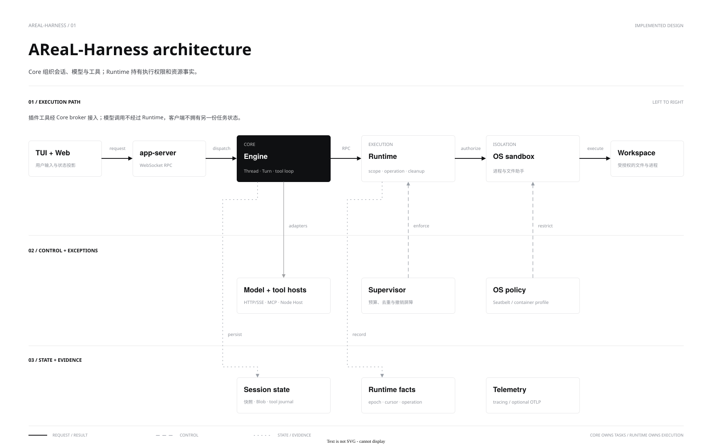
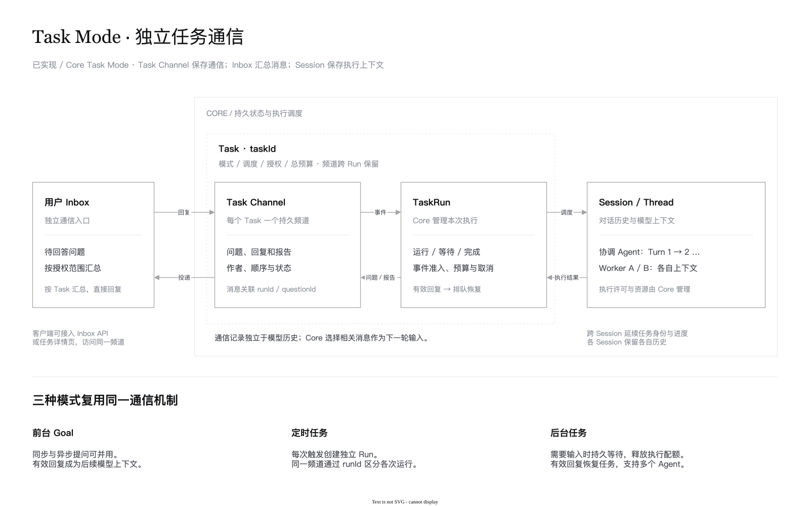

**中文** | [English](architecture.en.md)

# 架构与目录

AReaL-Harness 采用 **Clients → Core → Runtime** 分层。Core 是会话、Turn、模型循环与 Agent 状态的唯一所有者；Runtime 只处理执行权限、操作事实和资源生命周期。客户端不维护另一套权威历史。



[draw.io 源文件](diagrams/architecture.drawio) · [PNG](diagrams/architecture.png) · [图表规范](STYLE_GUIDE.md)

## 模块职责

| 模块 | 职责 |
|---|---|
| `clients/cli`, `clients/tui`, `clients/web` | CLI、终端和本地 Web；初始化连接、显示投影与提交请求 |
| `clients/gui` | React/Electron 桌面客户端；窄 IPC、原生资源、公开服务发现与可重建投影 |
| `core/config` | 解析用户配置、来源、凭据引用和 Skill 目录，定义工具宿主的代理环境白名单；不依赖 Engine 或 Runtime |
| `core/protocol` | 客户端协议投影和共享类型 |
| `core/engine` | 模型、工具、历史、持久化、父子任务和 Workgroup |
| `core/app-server` | WebSocket、认证、订阅、回调关联；不拥有另一份历史 |
| `core/local-service` | 共享服务发现、配置兼容性和控制客户端，只依赖 config/protocol |
| `core/service-host` | Rust 可信 launcher 和独立本地服务宿主，管理 Core/Runtime 生命周期与私有管道 |
| `core/server` | 装配配置、模型、MCP、Host、Runtime 和关闭流程 |
| `core/plugins` | Codex 兼容插件包解析、本地 marketplace、摘要缓存与安装/启用事务；不执行包代码 |
| `core/mcp` | 官方 rmcp 客户端与结果适配，不拥有 Turn |
| `core/sdk-typescript` | 选定 DSH 工具/文件服务适配和独立 Node Host |
| `runtime/protocol`, `runtime/client` | 独立执行契约与 Rust 私有管道客户端 |
| `runtime/supervisor` | Scope、权限收窄、祖先预算、去重与清理 |
| `runtime/host-tools` | Core 与原生后端共用的可信宿主工具发现；不执行任务、不授予权限 |
| `runtime/exec-native`, `runtime/fs-helper` | OS 沙箱、进程/PTY 与描述符文件操作 |
| `runtime/daemon` | 二进制、Cordis 装配与私有 RPC |
| `runtime/sdk-typescript` | 可信宿主独占连接的底层 Node.js SDK |

`supervisor` 依赖 `protocol`，`exec-native` 实现 Supervisor 后端接口，daemon 负责装配。Engine 不依赖 app-server 或客户端；配置由 server 解析并注入，SDK 不自行寻找用户配置。

Linux `exec-native` 为每次执行启动同 crate 提供的独立 Rust 二进制 `areal-runtime-reaper`，由它作为 subreaper 拥有实际命令及被收养后代的等待与回收；Runtime 等待 helper 并核验私有退出/清理回执。helper 与 daemon、文件助手一同发布在 `libexec/areal`，不依赖 Python。macOS 在进程组清理之外，使用 `libproc` 跟踪和清退已观察到的后代。这些职责不放入 Core 模型循环，也不替代外层服务管理器或容器 init；平台差异与保证边界见 [Runtime 清理契约](../api/runtime.md#输出与清理)。

Engine 的 `trajectory` 模块记录模型和工具的执行内容，通过 `tracing` 暴露轨迹；server 的 `telemetry` 模块装配标准 OpenTelemetry Traces/Logs SDK 和 OTLP 导出。Engine 不读取遥测环境变量，也不依赖上报后端；配置见[轨迹上报](../guides/configuration.md#opentelemetry-轨迹上报)。

server 在安装遥测时为 Engine 注入共享采集预算；Engine 用借用序列化与有界流式缓冲保存逻辑消息和最终模型请求，容量不足只丢弃遥测副本。持久事件桥接层负责 Turn 序号和终态清单，接收端据此区分执行完成与完整送达；协议见[Core 轨迹契约](../api/core.md#持久轨迹协议)。

可选持久轨迹导出由 `core/config` 解析 `[trajectory]`，`core/server/trajectory` 管理有界内存缓冲、磁盘队列与独立上传进程。队列默认位于用户 home，按配置文件身份隔离，同一配置的共享服务和独占 CLI run 共用；网络上传不进入 Turn 结算或 Runtime 生命周期。CLI/TUI 通过可取消后台检查报告一次异常，GUI 按可见性轮询状态；客户端只读取导出状态，并通过 Core 的公开控制入口切换启停或请求重试，远端按标准 OTLP Logs 接收，平台分析登记属于接收端集成。配置、容量与失败边界见[持久轨迹导出](../guides/configuration.md#持久轨迹导出)。

Skill 发现由 `core/config` 根据可信启动参数执行，只返回元信息和独立告警；其无状态文件头解析器由 Engine 的显式部署登记复用。Engine 不自行查找用户配置。`core/engine/src/desktop/skills.rs` 保存登记目录描述符，异步、有界地读取当前资源，不持有 Skill 内容快照。配置与读取契约见 [Skill 指南](../guides/skills.md)。

Codex 兼容包由 `core/plugins` 持有本地安装与范围选择；Engine 登记不可变插件 Skill 根，并在 Turn 提交时固定引用、读取时检查当前撤权。普通会话可以发现新安装，显式 Profile、Side 和隔离 worker 不自动扩权。onboarding 使用已有普通 Turn 入口；客户端通过现有管理收据恢复 UNKNOWN。独立 Skills 保持动态描述符读取契约。当前支持及限制见[插件指南](../guides/plugins.md)，后续完整兼容任务见[实施计划](../development/codex-plugins-plan.md)。

插件来源解析仍归 `core/plugins`，Git/npm 不执行安装脚本。`core/mcp` 持有认证、资源与连接版本，Engine 固定 Turn 的 schema/调用对象并拥有撤权、受理和清理。Apps 绑定 Core 进程 epoch、Thread 与包摘要；Electron 的独立沙箱只持窄能力。文件实际读写复用 Runtime 的目录描述符助手，模型投影剔除 `_meta`。原始 Connector ID 通过明确映射接到 GitHub；客户端凭据仅由可信启动环境注入。

插件下载与准备不持有 Engine 目录刷新锁；Store 的跨进程锁和 revision CAS 负责提交，随后从同一安装状态快照在刷新锁内发布目录，连接排空在锁外执行。MCP 清理未确认以类型化错误进入 `cleanupUnknown`，不能按普通失败重连；没有清理凭据的后续断开操作也不能清除此状态。跨实例共享启用状态与本实例受审阅定义分开：hook 调用前读取当前启用状态，后台协调取消已停用包的在途 hooks（包括升级后新版已删除定义的旧调用）；固定 Turn 版本不会固定启用权限。显式 Profile 默认排除插件，仅部署定义的 `allowPluginSkills` 可选择加入，且子任务继续受父任务插件范围约束；hook 角色与 matcher 使用已受理 Profile 身份，压缩保留子任务归属。状态轮询只读安装状态，不枚举包。组件解析按包身份、摘要和政策缓存，每次使用通过 NOFOLLOW 描述符检查文件/目录身份、权限、大小、mtime/ctime；变化后重新校验完整摘要。MCP 调用只验证所属包。该缓存不增加对任意同 UID 并发目录替换的隔离承诺。

插件 MRTR 在 `core/mcp` 通过现代 discovery/协商运行，Engine 绑定同一逻辑调用、逐轮权限和取消；opaque requestState 不进入 Renderer。原生文件选择归 Main，Core 校验字段/世代并委托 Runtime 以 NOFOLLOW 描述符导入受限快照，Renderer 只见不透明资源 URI。认证配置仅持安全存储引用；认证挑战与实际发送 token 的拒绝归 MCP 私有连接。App 订阅按实例/URI/世代共享首订阅、末退订，关闭与通知使用同一生命周期边界。

Goal 模式由 `core/engine/src/goals` 管理持久目标、请求账本与跨 Turn 续轮；用户队列与自动续轮共用准入入口。Clients 只维护投影，Runtime 沿用原执行边界。接口见 [Core API](../api/core.md#goals)。

交互式 TUI 与 Web 启动入口连接到同一部署服务；宿主独立于窗口存活，Store 保持单写者锁。Desktop Main 可直接复用发现与控制入口，见[本地服务契约](../api/local-service.md)。

Core 的生命周期判定区分普通停止准入与取消后的执行结算。Desktop 仅叠加自身连接和在途操作条件，可信 Main 的共用生命周期入口负责观察、确认范围及原实例退出核验；启动恢复、更新和菜单停止复用此入口。取消意图贯穿公共服务宿主，Queue 输入持久保留；部分停止和未知回执保持恢复状态，不由客户端推断全局回滚。接口见[桌面 API](../api/desktop.md)。

Task Mode 由 `core/engine/src/task_mode` 管理 Task/TaskRun、定时触发、独立 Channel 和 worker。它复用 Goal 账本与 Thread 准入，通信状态由 Core 持有；Inbox 是授权问题的查询投影。TaskRun worker 可跨协调 Turn，在独立 Session 中执行，仍由 Core 负责取消和结算。接口见 [Task 契约](../api/tasks.md)。

定时任务管理界面复用普通 Messages 与 Composer，直接复用普通会话的 TaskResourcesPopover；ConversationStatusCard 增加任务描述与状态概要，不建立固定右栏。宿主 task-draft 在同一管理 Thread 中解释 Agent 回复并校验保存；Core 历史保持原样，界面只读取解码后的显示投影。创建收据和逐轮修改收据阻止重复处理；执行限制不由 Renderer 的权限菜单解除。新建先明确选择项目与工作目录，再建立管理 Thread；项目内子目录由宿主和 Core 校验，独立任务目录仍归 ProjectlessWorkspaces 分配。管理 Thread 与执行 Thread 分离，执行锚点继承管理 Thread 的 cwd。提案摘要基于稳定解析结果；重复时间仅在提交边界推进至未来，修改省略频率时继承原值。安排与控制消息的成功状态仅来自匹配宿主收据。定时 Task 的根 Thread 只定位执行环境；每个 Run 新建会话并冻结配置。Core 持有触发、离线补执行和忙碌跳过，经认证桌面 Host 通过 prepare/ready 提供配置及工具。暂停安排只影响后续触发，停止或恢复通过 Run 控制，审批超时保留受阻执行。



[draw.io 源文件](diagrams/task-mode-mailbox-architecture.drawio) · [异步交互流程](diagrams/task-mode-mailbox-flow.svg) · [流程源文件](diagrams/task-mode-mailbox-flow.drawio)

`clients/cli` 提供 Rust 命令入口 `areal`，分派到 TUI、非交互客户端、Core server 和服务宿主的库入口；Core 不依赖客户端。`core/service-host` 的 Rust launcher 持有独立 Core/Runtime 进程与私有生命周期管道，Linux 不依赖 Python；macOS 的可信 service-host、launcher、Core 和 Runtime 由 `/usr/bin/python3` 作为实际父进程启动，以满足本地可执行文件的启动约束；`core/local-service/native_process` 只适配服务链的进程身份、显式描述符与生命周期，不参与 Runtime sandbox 或权限决策。`scripts/launch.py` 保留用于开发脚本与独立评测入口。发行目录 `bin` 只含 `areal`，Runtime daemon/file helper 放在 `libexec/areal`，不并入客户端进程。命令契约见[客户端指南](../guides/clients.md)。

## 状态与执行

同一 Thread 的变更串行，不同 Thread 可并发。模型请求、工具等待及子任务等待不跨等待持有会话锁。模型许可不跨工具执行持有，活动 Turn、模型请求和 OS 进程是独立限额。

工具先持久化意图，再提交 Runtime 或外部宿主，确认后记录结果。Store 的热快照与不可变 SHA-256 历史分段共同保存权威历史；先同步冷分段再提交快照引用，模型仅使用有界 checkpoint 与近期原文。媒体和大工具结果原文存入按 SHA-256 寻址的 Blob；工具结果引用由所属 Thread 的调用记录授权，首次工具结果视图只生成一次并随历史持久化；显式启用的实验观察投影只影响模型请求，不回写权威历史。重启将未完成执行标为 UNKNOWN；不自动重放。归档释放热历史，drain 后 GC 按引用回收 Blob。

Engine 的 `context` 与 `history` 模块统一规划完整模型请求，校验压缩候选后交由 Store 原子保存；Clients 只显示预算与压缩结果。分配与失败规则见[上下文管理](context-management.md)。

普通[Agent 委派](multi-agent.md)共享工作区、独立上下文；[Workgroup](workgroups.md)使用隔离写工作区并验证制品。Core 管调度，Runtime 不选择并行宽度。插件、stdio MCP 与 Core 仍是可信宿主；broker 权限不等于 Host OS 隔离，见[插件边界](plugins.md)。

可选[研究 Agent](../guides/tools.md#research-agents)由 Core 管理只读源码、私有 scratch 与共享预算，默认异步派发，是否委派由模型决定。短句柄缓存属于活动 Turn，压缩保留、结束失效；Store 继续保留原始执行历史。模型 HTTP 层记录脱敏参数与用量，未完成响应恢复不重放已执行工具，见 [Core API](../api/core.md#recovery)。

`core/engine/src/model/tool_calls.rs` 统一请求级工具缓冲预算与脱敏诊断；Engine 提供执行额度，模型适配器在积累响应时约束资源。媒体自动无损压缩应由模态预处理负责，并单独验证还原一致性；当前工具缓冲预算按原始 UTF-8 字节计量，不触发媒体压缩。

Engine 的 `diagnostics` 模块对非权威排障制品执行有界保留，server 装配启动与周期清理；service-host 管理宿主/launcher 日志与握手临时目录的租约回收。诊断回收不改变历史与 Goal 账本的恢复语义，策略见 [Core API](../api/core.md#recovery) 和 [本地服务契约](../api/local-service.md)。

Fork 与 Side 的开发预览复用上述 Core/Runtime 所有权：Engine 创建独立根 Thread/Session，Store 为目标持有不可变继承或参考快照；`conversation.origin` 不承担 Agent 委派、取消或权限继承。Fork 只分支对话，使用当前共享工作区；Side 的持久只读角色在旧执行入口、模型工具和 Runtime Scope 中校验。主会话与 Side 共用 `Messages` 与 `ConversationComposer` 展示边界（Lexical 输入与模型目录菜单）；各自控制器保留草稿、首问回执与配置归属。Renderer 只投影分页历史、相关讨论和草稿回传；关闭面板不结束 Core 工作，回传只追加本地草稿。协议与权限边界见[桌面 API](../api/desktop.md#turn-fork-开发预览)。源码实现与局部验证不等于完整 P0 验收；原生桌面路径、完整组合验收、安装包与真实供应商证据仍需分别完成。

共享 Browser 的普通网络加载使用 Chromium 的系统代理、DNS 与站点策略；Main 只隔离活动控制端口，网页不取得产品 bridge。适配器把用户新发送绑定到确切 Turn 和 GUI 连接，首次经 Core 审批的工具发现才懒绑定当前原生页；不以 `thread/resume` 抢宿主。人工键鼠事件由 Main 在派发前撤销页面读取与动作代次，排空在途输入后交付首个用户事件。Core 的读取和动作许可绑定页面、控制代次及具体计划，UNKNOWN 不重放。产品流程及局限见 [Browser 契约](../api/browser.md)。

## 仓库目录

桌面客户端归属见[迁移决策](../adr/0001-desktop-client-module.md)。`clients/gui` 的独立 Electron 适配器保留系统凭据与订阅转发，通过共享服务公共入口连接 Core；退出 GUI 不终止 Core 任务。macOS 安装包中，前台与后台适配器使用不同的应用身份，后台共享主包资源与原有数据目录，避免 Finder 将重开前台的请求交给无窗口后台。GUI 构建、数据隔离与本地包见 [GUI 指南](../../clients/gui/README.md)。移动端源码后续迁移。

桌面适配器的项目连接所有者管理退避、连接身份和快照重订；被动恢复只连接兼容的运行中服务，不启动或重启 Core、不重放未知提交。Main 的首次自动初始化比较部署内容身份，仅通过既有生命周期 `ifIdle` 判断替换空闲后台；活动工作和其他 GUI 阻止换代。停止结果未知时保留持久意图，只核查、不重发或启动新后台；Core 的配置与权限重启边界继续生效。Workbench 共享桌面能力契约，Main 和服务入口校验各自允许的能力并保留结构化错误；Core 仍拥有配置和执行的最终校验。原生预览归 Electron Main，按项目/Thread 释放并有界缓存页面；界面从 Main 的权威快照投影每页一个顶层标签，与文件和终端共用标签栏；页面列表订阅归当前项目/Thread 的窗口投影，标签使用 `pageId` 定位，不建立另一套 Browser 生命周期或执行权限。具体恢复、类型覆盖及页面状态丢失边界见 GUI 指南的生命周期章节。

[Remote v2](remote-control.md) 的 Gateway 归现有桌面后台适配器，浏览器只持有受限投影；Core 与 Runtime 继续拥有执行和历史。Direct 与 Relay 共用 RemoteControl 拥有的 session acceptor、观察器和授权预算，传输适配器只提供字节/存活/背压。Direct 使用独立低权限入口，Relay 仅拥有连接路由与登记元数据；两者都不转发高权限本地接口。契约与实施状态见 [Remote API](../api/remote-control.md)，决策见 [Host 所有权](../adr/0008-remote-host-ownership.md)。

Remote 的 React Workbench 直接复用桌面 `Messages`、`ConversationComposer`、模型/权限菜单、`ComposerQueue` 与 `GoalCard`。浏览器控制器仍拥有配对、代际、草稿与 commandId 核对；项目/Session 来自授权 Core 概览，详情使用有界原子订阅。`session.control` 只接收模型/权限、目标与文本队列意图，Gateway 校验后经现有 journal 派发；不提供通用 Core RPC 或凭据访问。普通 Session 的排队提交使用 Core 原子归属/配置准入检查，工具执行与历史权威不迁入浏览器。

```text
core/                       配置、协议、Engine、server、MCP、插件 SDK
clients/                    CLI、TUI、本地 Web、GUI
runtime/                    协议、监督器、OS 后端、文件助手、SDK
schemas/                    固定上游与 AReaL 机器契约
examples/desktop-api/        直接 API、CLI 与发行验收
scripts/                    构建、检查、启动与 smoke
upstream/pins.json          上游来源与固定版本
tests/fixtures/             确定性工具、hooks、MCP
tests/e2e/docker/           Linux 受控执行镜像
tests/perf/                 lite/pro、runner、grader 与统计
tests/perf/suites/pro/cases/*/environment/  公开 Dockerfile、原始输入与运行库校验
docs/guides/               使用与配置
docs/api/                  接口契约
docs/design/               分层、机制及 diagrams/ 源文件与预览
docs/development/          开发、测试与依赖维护
docs/examples/             示例说明
docs/benchmarks/           运行方法与 reports/ 历史报告
```

接口细节见 [Core](../api/core.md)、[Runtime](../api/runtime.md) 与 [SDK](../api/typescript-sdk.md)。当前范围见[功能清单](../features.md)，验证入口见[测试](../development/testing.md)。

Core server 负责配置监听与模型装配，Engine 在提交时固定模型版本并保留队列快照；本地服务客户端负责安全重启与发现，Runtime 权限仍属于部署边界。见[配置指南](../guides/configuration.md)。

Core `permissions` 负责审批模式、规则优先级与精确请求记忆；Clients 展示并回答请求。Runtime 独立执行部署上限及 Scope 收窄，本地 full-access 由可信 launcher 选择。见[权限配置](../guides/configuration.md#permissions)。

[权限架构提案](permissions.md)建议在上述分工下引入受限自动执行预设和 Core 授权代理：命令规则只决定是否询问，附加能力只授予具体操作，并继续受部署、Profile 与父任务上限约束。该提案待评审，尚未改变当前默认值或执行契约。

外部评测平台通过公开契约消费原生 CLI 和标准发布包。输入适配、终态结果投影、产物收集和平台部署由消费平台维护；Core、Runtime、SDK 和独立发行包不依赖平台适配器，见 [CLI 契约](../api/claude-cli.md)。

模型目录的解析、校验、凭据状态诊断和受控文件写入归 `core/config`，`core/server` 在启动时装配为 Engine 的执行投影，并复用凭据解析规则。Clients 使用公开配置命令，不复制 TOML 解析或凭据规则；桌面安全存储只在可信适配器中提供密钥及注入来源信息，由 Core 返回凭据来源和就绪状态；Renderer 不读取密钥。“无需认证”复用共享文件中不配置凭据引用的语义，不建立另一份供应商配置。GUI 默认与 CLI 共用用户配置文件；独立服务登记目录由 `core/local-service` 选择，不改变配置查找，运行数据仍按 GUI 部署隔离。共享目录保存与安全重启分开，任务持有原模型快照；契约见[配置指南](../guides/configuration.md#gui-与-cli-共享模型目录)。

macOS 系统静态代理由 GUI 可信后台适配器读取，转换成标准代理环境后注入 Core；模型设置与订阅的 Node HTTP 请求使用同一快照。SOCKS 的固定上游 TCP 转接由此后台持有，持久监听端口用于后台恢复，不解释模型协议或保存请求内容。Core 和 Runtime 不依赖 Electron 或 GUI 的系统命令适配，运行中的服务保留启动环境；规则与限制见[代理配置](../guides/configuration.md#proxies)。

历史回取分页读取原始记录。Goal 计量同样把已结算请求滚入分段，保留累计用量与未结算预留。这些存储职责位于 Core，不改变 Runtime 的执行所有权。

`core/engine/src/delegation.rs` 是统一委派与执行投影门面，记录身份、所有权和后端引用；原 Thread/Turn 与 Workgroup 保留各自执行状态。共享作者租约、隔离快照和交付由 Core 协调，Runtime 不选择策略。`workgroup/delivery.rs` 组合候选、调用可信验收并持久化逐项交付回执，`runtime/fs-helper/src/delivery.rs` 实现受控分块提交与条件删除。Clients 只显示统一子任务与交付投影，高级历史入口保持兼容。接口见 [统一委派](../api/core.md#agent-tools)。

平台公开输入物化与清单属于外部消费端；只读目录身份、文件操作拒绝及 OS 挂载保护属于 Runtime。Core 的媒体工具生成有界派生图与动画视图，模型适配器计量最终请求字节；外部消费端不维护 Core 的模型循环。契约见[工具](../guides/tools.md)、[Runtime](../api/runtime.md)和[评测](../benchmarks/README.md)。

共享 Browser 沿用 Core 会话、审批与历史所有权，独立桌面适配器负责认证工具回调，Electron Main 拥有原生页面，Renderer 投影状态。已实现能力通过 Host 发现；持久 Profile 与云浏览器等延期能力仍属于设计范围之外。契约和限制见[Browser 规格](browser.md)、[Browser API](../api/browser.md)及[所有权决策](../adr/0002-shared-browser-ownership.md)。人工独立 Frame 授权与逐 Frame 截图隐私检查也归 Main，绑定当前 Human Page，不授予 Agent 跨源权限，复用既有 ThreadBlob/MediaRef。源码实现不等于安装版或真人验收通过。

`core/engine/src/observations.rs` 在显式启用实验策略时，于模型历史投影层实施旧工具观察的软预算，原文由 Store 保留，不改变 Runtime 操作。配置与兼容性见[配置指南](../guides/configuration.md)。

Core 可通过默认关闭的实验配置，在请求投影与检查点证据中有界保留完整文件参考；执行等待仍由 Runtime 管理。参考回取、非交互 stdin 和连续失败上限见[配置指南](../guides/configuration.md#参考保留与有界工具恢复)。

## 插件 Hooks 所有者

`core/plugins/{hooks,hook_sources}` 只解析原包和受控用户/项目来源、matcher、模板与摘要。`core/engine/src/plugin_hooks` 拥有独立定义信任、Session/Turn 布点、持久受理与结果投影；同步任务同时登记在 Session 与当前 Turn，后台任务由 Session 持有。Runtime 沿用路径授权、进程预算、有界任务组写入调度和确认清理，hook 不继承任务 provider 秘密。Main 仅转发管理与恢复收据，Renderer 审阅当前定义；安装和 MCP 信任不能替代 hook 信任。

MCP hook 绑定原工具 generation 与真实 Turn/compaction owner，取消旧 owner 不得移除新 owner。`core/mcp/active_timeout` 在同一逻辑请求的全部 MRTR rounds 中扣减活跃预算，broker 的人工等待守卫暂停该预算；取消/撤权不暂停。管理提交按业务键跨执行去重，日志发布短时串行并为每个在途响应预留空间，因此等待表单不挡住上传或撤销。Core 持有 epoch 绑定的 Session Task Scope；Runtime 校验 Hook 类型参与及有界组 FIFO，不扩大各进程授权。同任务 Hook/Ordinary 可重叠，ordinary/ordinary 与跨任务冲突仍独占；关闭先等待任务再关闭 anchor，UNKNOWN 不重放。普通只读子任务 command hooks 需要另行同意并绑定摘要，准入与实时检查使用同一条件，继承计划也须过滤。Runtime 确认受限隔离，只授予工作区/包读取和私有 scratch/本插件 data 写入，禁止网络和 provider 秘密继承；data 根固定身份，重定向拒绝。Side/研究任务/nativeTaskAgent/受限 Profile/只读根会话/MCP 继续排除，见 [P2 矩阵](../development/codex-plugins-p2-acceptance.md)。

用户评价在 Clients 层冻结公开历史并复用独立 Side；Core Server 仅适配既有轨迹接收端。边界见 [user feedback](../guides/user-feedback.md).
