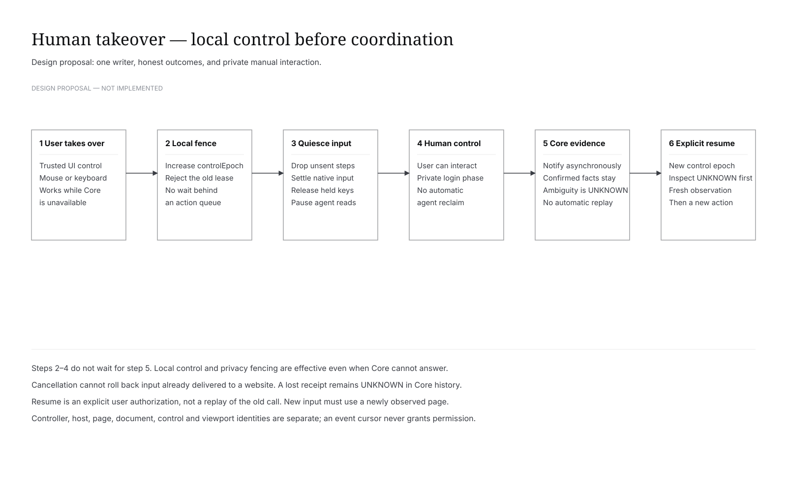

[中文](browser-ux.md) | **English**

# Shared Browser interaction specification

Proposed design, constrained by the [spec](browser.en.md) and [contract](../api/browser.en.md). Reuse existing components, Composer, ApprovalRequest, resource and diff surfaces rather than replacing the design system.

## 1. Structure

Use the existing right workspace with split/expanded viewing while retaining chat and Thread identity. Keep back/forward, reload/stop, address, Page tabs, viewport and controller status in a trusted toolbar. Takeover stays visible above web content. Background Thread activity never steals focus, switches chat or opens a different user's panel.

An activity strip shows the current target, progress and takeover, not raw CDP traffic. Completion presents a verification card linking checks, evidence and code changes. A historical card is not a live interactive page.

## 2. Control states

| State | Presentation and behavior |
|---|---|
| human | “You control this page; agent observation paused”; normal interaction, comments and explicit resume |
| agent | “Agent controls this page”; trusted input shield and takeover; read-only following |
| transferring | Handoff progress with possible in-flight uncertainty; local takeover always works; no new agent input |
| waiting approval | Existing Core approval card showing actual site/action; clicking Allow is not local execution permission |
| unavailable | Specific host/page failure and restoration impact; no fake live preview |
| unknown | “Outcome unconfirmed; will not retry automatically”; inspect page/receipt and acknowledge without rewriting history |

Takeover immediately fences locally. Open human input only after native synthetic input quiesces; otherwise remain transferring and offer safe page stop/closure. Do not wait for Core approval or permit competing writers.

Stop loading, take over Browser, interrupt Turn and stop service are distinct controls. Browser takeover does not stop unrelated development servers.

## 3. Journeys

**A. Inspect the existing page.** The user has unsent form state, chooses “Let agent inspect current page”, confirms the Thread/URL/scope, and binds the same Page. Observe semantically and capture when needed. E2E must compare native object identity and a sentinel, not only URL. Prefer claiming the intended existing page over opening a duplicate.

**B. Manual login then resume.** Keep the page open when login, permissions or sensitive submissions need a person. Human takeover pauses automated reads and diagnostics. Explicit “Resume and continue” grants a new epoch and fresh observation. No restart-persistent login promise; merely changing window visibility is not consent.

**C. Region annotation.** Take human control, capture a provenance-bearing page view, hide the native surface and annotate the frozen image. Label it as a capture whose live page may still change. The draft contains region/comment/thumbnail/URL/time and remains bound to its original Thread. Only explicit send submits; cancel restores the page without navigation. Region dragging uses the frozen image; element picking uses the visible native page's CDP Overlay inspect mode. Both use the same guarded capture and original-Thread draft path. Native B-29/B-30 acceptance remains pending.

Current source path: the user-initiated `captureRegion` preview command waits for native input convergence and captures only a visible human-controlled Page. The native Page remains pinned while its frozen editor is open, including across chat switches; cancel releases the pin and restores that Page without navigation. Selection maps rendered image coordinates to captured bitmap pixels. “Add to chat draft” appends the comment, Page/document/viewport/bitmap provenance, clip coordinates and cropped PNG to the original Thread's Composer draft; the user sends explicitly from Composer. Only the selected crop is uploaded through the existing Thread-scoped Core Blob/MediaRef path during explicit Composer send; the full capture stays local. Core history owns the annotation only after message admission. A pending or in-flight submission blocks staging another annotation until its outcome is inspected. The frozen editor remains in memory across chat switches; Composer text uses its existing local draft storage, while the image attachment follows the existing in-memory attachment lifetime.

**D. Element annotation.** Current source path: on a visible human-controlled native Page, the user starts “Select element and annotate.” Controller exclusively enables DOM/Overlay inspect mode on that Page, receives the native node hit, disables the overlay, then takes the existing privacy-guarded region capture. It reads actual AX role/name, bounds, Frame/document and control identity on that same Page and crops the frozen image. Cancellation, timeout, or a change in page/chat identity discards late results. The returned `human:` Ref is historical evidence and never enters the Agent action Ref cache; the Agent must freshly `observe`. Before staging, a check compares node identity, semantics, bounds and viewport; a change preserves the original image/text and marks it `stale`. The comment, crop and provenance enter only the original Thread's Composer draft. Explicit send uses the existing Core Blob/MediaRef upload and message admission. No privileged page bridge or raw model CDP exists. React source location remains unknown without an actual project-provided, attributed mapping.

Missing semantics, Canvas internals, and unresolvable iframe/Shadow content provide a reason and fall back to region feedback, never a guessed selector. If the existing privacy guard cannot read a cross-origin Frame, it refuses the image; the UI cannot claim a region crop in that case. Real native B-29/B-30 selection, stale, and fallback acceptance remains pending M2.

**E. Edit and verify.** Runtime starts/reuses the project service and supplies its observed endpoint. Inspect baseline, receive comments, edit source, wait for observed update conditions, then capture and check behavior/appearance. Link call, code change and evidence. Show behavioral checks, visual judgments and user acceptance separately; build success is not visual acceptance.

**F. Temporary style experiment.** Human-only constrained text/color/font/spacing/size edits with undo/redo, always labeled “Page preview; source unchanged”. Track old values and document identity; remove only overlays owned by the experiment. Navigation/HMR replacing the target invalidates it rather than overwriting new app state. Send intent and before/after evidence for a subsequent source edit. Clear temporary overlays before final verification, so an unchanged source cannot appear fixed.

## 4. Native-view constraints

React z-index is not a WebContentsView overlay implementation. A trusted native overlay/local view must handle resizing, focus, IME, occlusion and display scale without granting remote pages a privileged preload. In agent mode it blocks human page input but retains takeover; in human mode it revokes agent admission. Capture web content without agent cursor/labels/toolbars by default.

Do not fabricate screenshots while minimized, hidden, zero-sized or unsupported. Request a visible page when needed rather than present an old capture as new evidence. Remote video infrastructure is not required initially.

Explicit DevTools opening pauses automation. Detach marks the driver unavailable. Closing reattaches with fresh generations/observation; old prepared actions expire. Never rely on incidental multiple-debugger behavior.

## 5. Responsive input and accessibility

Store page CSS viewport separately from GUI display zoom. An initial1280×720 viewport and configurable320–3840×320–2160 range are policy values, not browser guarantees. Record bitmap and CSS sizes. Test center/edge/scrolled/iframe/Canvas coordinates at1×/2× display scale and multiple page zoom values.

Only genuine human-mode input goes directly to the page. IME confirmation Enter must not submit a comment or chat. Clear synthetic keys without disrupting human composition. Keyboard navigation reaches takeover, approvals, address, tabs and comment actions, and restores focus to the initiating control. Use text labels and accessible state announcements, not color alone.

## 6. Files and permissions

Attribute popups to opener, Thread and transient context before accepting; no unowned windows. Recheck cross-origin login transitions. Deny camera/microphone/location by default initially and hand the flow to a person.

Show download origin, name, size-or-unknown and state; save only after user confirmation and never execute. Uploads use a trusted user chooser, not model-specified host paths. Cancellation is a normal outcome. Files selected during human control are not automatically read by the agent.

## 7. Acceptance evidence

Capture real evidence for same-page action, takeover/resume, region/element comments, source verification after clearing style overlays, and unavailable/error states. Distinguish unverified/passed/failed/unknown rather than one generic success badge. See the [test matrix](../development/browser-testing.en.md).

[Editable takeover diagram](diagrams/browser-takeover.drawio)
