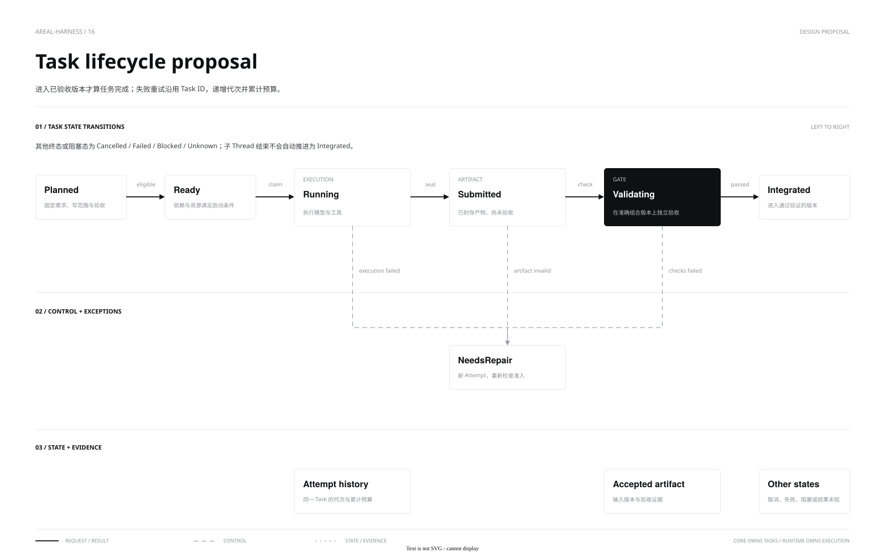

[中文](multi-agent.md) | **English**

# Agent delegation and admission

Ordinary tasks use one family of `agent_*` model tools and the `areal/agent/delegate` client entry point. The coordinator declares inspection or modification intent, the requested result, and dependency constraints. Core chooses shared execution or [isolated Workgroup execution](workgroups.en.md), projecting status, verification, and delivery through one `executionId`. Children retain the production Engine and independent histories, with inherited or narrowed permissions. Legacy `areal/agent/spawn` and explicit Workgroup RPC/CLI remain compatible but are not two ordinary model menus.

[Source](diagrams/task-lifecycle.drawio) · [Admission diagram](diagrams/agent-admission.svg) · [Admission source](diagrams/agent-admission.drawio)

## Selecting execution

Delegation is optional, not a fixed stage of every task. The model delegates a concrete separable question or change with useful stopping evidence when coordination is worthwhile. Small, tightly coupled work and results immediately needed by the parent stay local. Core admits structured intent against actual capabilities; it does not plan from case IDs or text length or impose a delegation quota target.

Shared and isolated execution preserve different capabilities without another model loop. Core admits structured requirements against existing authorization, the workspace, and execution environment. The selected strategy and reason are diagnostic records; users do not select a backend.

| Task conditions | Execution strategy |
|---|---|
| Analysis, search, or review | Independent context; shared read-only by default, or inherited parent authority when explicitly configured |
| Coupled changes, current-environment requirements, or no independent change boundary | Exclusive writer in the shared workspace |
| Declared independent changes and exact write paths, with a snapshot-compatible workspace and available isolation | Isolated execution followed by candidate integration and delivery |
| Candidate-only patch or trusted verification required | The relevant isolation and verification guarantees are mandatory; unavailable guarantees return an explicit error |

An ordinary independent modification can select a shared exclusive writer before starting when isolation is unavailable. A started execution does not silently switch strategies after failure. Shared write exclusion covers actual tool side effects so the coordinator and children cannot simultaneously change code under verification. A declared isolated write set assigns responsibility; it does not expand host authorization. Read-only restrictions, denied tools, Profiles, Runtime limits, and root budgets remain effective.

An isolated worker Runtime inherits the network ceiling granted by the trusted parent Runtime. A parent that denies network, or an executor without a trusted host, continues to deny it; read-only child Scopes can narrow it further. Network authority grants no host file, credential or extra source write access.

Before admitting isolated work, the native executor starts a read-only Runtime in a separate empty directory and confirms shutdown to check the actual native sandbox prerequisites. Each service caches confirmed availability or unavailability. Runtime must also declare commandEnvironment. If an older Runtime omits this capability, confirmed probe cleanup precedes an upgrade requirement or selection of the current environment before creation. Ordinary modifications may choose shared execution only after the probe explicitly confirms startup rollback without retained resources. UNKNOWN probe cleanup rejects delegation rather than falling back; cancelling a waiter does not abandon the probe’s own cleanup.

Shared children also call Runtime `scope.check` with their frozen effective permissions before persisting history or sending their first model request. A shared read-only child of a full-access parent still requires a restricted OS sandbox. Missing capability rejects admission without widening permissions or repeatedly starting failing children. Handshake `restrictedScopes` is included in model environment facts. Older Runtimes without the query require an upgrade; admitted parents retain their existing permissions. See the [Runtime contract](../api/runtime.en.md#permissions-and-deduplication).

When Runtime explicitly reports restricted scopes unavailable, model tool declarations narrow accordingly: ordinary delegation retains modification intent only within existing authority, and hides creation if the parent cannot write either. Research read-only creation is hidden; existing-task reads, waits and cancellation remain available. Explicit inherit remains subject to parent authority. Tool visibility is not authorization: explicit, legacy and RPC requests still preflight the final Scope, and relabeling inspection as modification cannot bypass a read-only requirement.

Execution, verification, and delivery are separate projections. Automatic isolation without deployment checks can produce a candidate but must report checks as not run; model summaries and empty checks cannot claim trusted verification. `changes` delivers into the original workspace within authorization, while `patch` retains a candidate. Core preflights every target baseline and journals application; conflicts, partial application, and unknown outcomes are not successful delivery. See [Core API](../api/core.en.md#agent-tools).

The model-visible `agent_spawn.requireTrustedChecks` field follows the configured host verifier. Without a trusted verifier it advertises only `false`; child self-checks remain available and untrusted. Explicit RPC or older tool calls requesting an unavailable trusted guarantee are rejected before creating an execution, without silently relaxing it.

`intent` declares responsibility; authority is separate trusted configuration. Default `delegation.inspection_permissions="read-only"` preserves OS-enforced read-only access. Explicit `inherit` selects `sharedInherited`, inheriting effective parent authority without adding inspection-only file/network restrictions. Existing parent/Profile read-only limits and explicit legacy sharedReadOnly still apply. TaskRun workers also preflight their final Scope before registration or model requests. See [configuration and compatibility](../guides/configuration.en.md#inspection-child-permissions).

Shared writers and writable inherited inspectors do not acquire a writer lease for model work or trusted native reads. The first potential effect acquires the exclusive workspace lease, covering the current tool batch and yielded managed commands. Before the next model request, Core yields only when the owned Runtime Scope identity matches, active process count is zero and cleanup has no error; the next effect reacquires admission. Core records a bounded shared file-tree version before initial sampling, including ignored products, local Git state, directories and permissions. Reacquiring effect admission against a changed version returns CONFLICT before dispatch, retaining the lease until a new accepted model decision consumes the receipt. Commands are not replayed automatically; links, external Git metadata, the 64 MiB/20000-entry bound or overlapping Core state retain whole-Turn exclusion. Conditional writes still validate file versions; this does not establish transactions with external processes. Active processes, UNKNOWN cleanup, failed queries and unmanaged host effects retain the lease. Lock admission is cancellable, coordination queries hold no workspace lease, and recursive delegation and cross-Turn development services remain restricted.

Shared writers or inherited inspectors with frozen plugin lifecycle hooks acquire the whole-Turn writer lease before hooks run. Runtime process counts cannot certify that delayed hook or external host effects have ended.

Shared and isolated executions expose handoffs with provenance and pagination, retaining partial-work semantics while running, failed or cancelled. Isolated workers use agent_report without gaining recursive delegation. Coordinators inspect capabilities before sending live input; isolated contracts remain frozen. See [Core API](../api/core.en.md#agent-tools).

## Ownership and settlement

Creation serialization belongs to each parent session and protects request idempotency and cumulative child admission. A slow probe for one parent does not queue unrelated parents. Isolated admission rechecks the cumulative limit after the probe and before reserving capacity, including races with the legacy spawn API. Model requests, active Turns and tool execution retain their separate global limits.

Model-spawned children progress asynchronously. The parent receives results in completion order and joins all children before normal completion. Waiting holds no model or ordinary tool permit. Manually spawned RPC children retain cancellation when the parent Turn ends. Cancellation, timeout and failure propagate downward; terminal state follows resource closure and persistence.

Native-child reads and automatic completion share a consumption record within the parent Turn. Only terminal receipts from built-in coordination tools in the input of a successfully completed model response acknowledge a result version. Legacy `threadId` and shared-execution `executionId` resolve to the same child Thread/Turn; an unchanged, already supplied result does not require another answer. Running children, late terminal updates, unread initial pages, and omitted reports retain the existing wait and synthesis behavior. Consumption survives compaction within the Turn, without certifying model understanding or verification; failure and resource-release state are compared separately. An identical automatic summary already retained in the current context is not appended again; existing model history is not rewritten. See the [repair and validation report](../benchmarks/reports/child-result-consumption.en.md).

Legacy research-agent creation, waiting, and cancellation also hold no workspace read lease or tool execution permit, preventing a cycle between a waiting parent, a queued writer, and child reads. Their pre/post hooks acquire workspace leases and tool permits for each actual execution, preserving approval, permission, and cancellation boundaries. An external tool with the same name receives no coordination exemption.

`agent_report` persists summary, evidence and remaining work without ending the task. A failed task can hand back its latest report while retaining failure and partial markers; successful completion prefers a newer final reply. Checkpoints are not independent verification. Ordinary child execution belongs to its parent Turn; TaskRun-owned execution retains its existing lifetime across coordinator Turns. Control requests validate that owner, and completed children cannot start detached Turns.

## Separate quotas

| Quota | Default and meaning |
|---|---|
| `max_threads` | 20000, including historical Thread metadata; archiving only releases hot history |
| `max_active_turns` | 256, including model queues, tool waits and cleanup |
| `model_concurrency` | 32, covering in-flight model requests only |
| `max_children_per_turn` | 64 successfully created direct children over the parent Turn; completion does not refund it |
| `max_agent_depth` | 8, with root depth 0; setting depth or fan-out to 0 disables delegation |

Child Thread and first Turn admission/persistence are atomic; rejection leaves no empty session. Capacity exhaustion rejects immediately rather than blocking a parent for space. Cleanup or final persistence failure retains active quota until Engine teardown and recovery. Restart validates ancestry without resuming execution automatically.

Tool availability does not guarantee delegation. Modification tasks should declare clear responsibilities. The unified entry point serializes shared writes; legacy shared delegation still requires nonoverlapping write coordination. Width, actual model-request overlap and task benefit are measured separately. Parameters, pagination and errors are in [Core API](../api/core.en.md#agent-tools).

`agent_send_input` is cooperative feedback rather than urgent cancellation. Core drains the child model request to settle usage before applying new input; stale response tools are not executed. Both the pre-header and streaming phases have bounded settlement waits of at most 180 seconds each, also subject to the stream idle deadline. Explicit cancellation can interrupt settlement; missing usage or timeouts remain UNKNOWN rather than being fabricated as settled.

Use default graceful `agent_cancel` for ordinary takeovers and explicit force for urgent interruption; deadlines and receipts are documented in [Core API](../api/core.en.md#child-stopping-and-usage-settlement). Parents compare source changes, verification output and snapshot activity, using full execution IDs and agreed handoff paths; legacy delegation still uses thread IDs. Core seals descendant admission before propagating cancellation. The Turn retains bounded model-settlement ownership, followed by existing cleanup and shared Goal gates. Resource release and accounting completeness are separate; takeovers never erase UNKNOWN.

## Source projection and execution environment

Isolated inputs include Git-tracked files, unignored untracked source and existing files in explicitly declared write sets, preserving dirty working bytes. Without Git, workspace-local `.gitignore` rules apply. Frozen inputs remain represented even if later ignored, including artifact collection and delivery conflict checks. Private workers do not inherit an ancestor repository index or ignore rules from their storage directory. Ignored products and dependencies are not copied implicitly; execution dependencies and read-only toolchains are provisioned separately. Source projection success does not certify environment availability.

Source and artifacts share bounded representation limits of 16 MiB per file and 64 MiB total. Unignored links, special files and oversized inputs fail explicitly without following outside targets or truncating data. Persistent store capacity remains independent. Each workgroup writes `source-projection.json` with policy, counts, bytes and tree digest. Freezing, composition and delivery retain workspace write admission; delivery does not delete unrelated ignored products.
