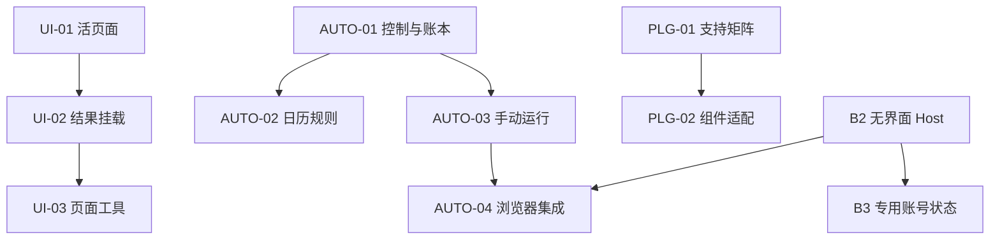

**中文** | [English](areal-zcode-comparison-codex-spec.en.md)

# ZCode 与 AReaL Harness 四项能力对比及 Codex 执行规格

## 结论与使用方式

建议保留 AReaL 的 Core 执行所有权，在现有实现上补齐长期可用性和产品闭环。ZCode 值得借鉴的是浏览器操作覆盖、显式无界面执行、日历与手动触发、UI 页面生命周期，以及插件组件的产品表达。两者都有成熟实现，也各有明确限制；不能按功能名判断谁全面领先。

本文件面向维护 AReaL-Harness 的工程师和 Codex。它包含源码差异、优先级决策、实现边界、接口提案、PR 切片、失败处理与验收要求；可以作为仓库 `docs/development/` 下实施规格的输入。这里所有“新增接口”“新增路径”都是提案，不能描述为当前已实现能力。实际落库到仓库文档时遵循 AGENTS.md 的中英文配对、文档导航与生成契约要求。

审阅基线：

| 项目 | 固定提交 | 证据范围 |
| --- | --- | --- |
| ZCode | [0a1fc56d279fd1001f78387bd81aec1c26767411](https://github.com/zai-org/ZCode/tree/0a1fc56d279fd1001f78387bd81aec1c26767411) | main 的客户端、服务、CLI runtime、适配器和相关测试定义 |
| AReaL-Harness | [dd3758cdbebbceb7b582bec0d357405f10bc8fba](https://github.com/areal-project/AReaL-Harness/tree/dd3758cdbebbceb7b582bec0d357405f10bc8fba) | Core、Runtime 接入边界、Electron/Main、Renderer 和相关测试定义 |

读取日期为 2026-10-20。本次完成静态源码审阅，没有运行两个应用、安装包或测试套件。源码可证明的路径、文档声明、尚需运行复现的结果分别标注。尤其不能将 AReaL 浏览器设计文档中的未来接口、ZCode UI_PLUGIN 文档的分支说明、测试文件的存在，直接当作发行版本已通过验收。

### 优先级标准

- **P0**：会破坏已提供功能的控制能力、任务持续性或编辑状态连续性的缺口。先有可复现实例，再合并实现；不凭“另一个项目有”就列 P0。

- **P1**：补齐高频任务的基本完成路径，依赖清晰，收益可以由功能验收证明。

- **P2**：新增执行模式、生态兼容或长期会话能力；有具体使用场景和依赖后再进入实现。

本次没有证据支持重写整个浏览器系统、调度器或插件系统。优先级是工程建议，不代表这些修改已经发生。

## 四项能力的主要差异

| 能力 | ZCode 当前源码 | AReaL 当前源码 | 建议决策 |
| --- | --- | --- | --- |
| 浏览器自动化 | browser-client/受限 JavaScript 调用面；Desktop 和显式 headless 两种适配；较完整的 locator/原生动作 | browser_v1、describe、Core prepare/approve/execute；Electron Main 的 WebContentsView；动作集合较窄 | 保留权限与动作账本，先补常用原语，再提供可选 headless Host。无需引入通用 REPL 或更换桌面视图 |
| 自动化与定时任务 | SQLite 中定义与 run 分离；独立 scheduler 派发；日历规则和 Run Now；Host 记录实际结果 | Core 单一 Task/Run/Goal 体系；UTC 时间点/固定间隔；Host 准备配置；已有恢复、预算、跳过和未读结果 | 修账本容量与停止可达性；补 Core 日历计算和 Run Now；保留同计划整次执行不重叠 |
| Plugin | 多类 manifest、commands/agents/UI surfaces；有组件目录和运行接入 | portable + Codex/Claude/Cursor 包；Git/npm/ZIP、摘要/CAS、MCP、Skills、Hooks、OAuth、Apps 和扩展已有 | 先做组件级支持报告；对已证实需要的生态逐项适配，复用现有安装和撤权，不建第二个 PluginStore |
| UI Plugin | MCP Apps 之外还有稳定页面 owner、surface、页面工具等能力 | 已有沙箱 AppBridge、消息/上下文、资源/文件和扩展能力；当前标签页切换会卸载文档；缺少已完成工具结果的直接挂载路径 | 先保住活页面，再把现成结果变成交互页面；页面提供工具、surface 和长期保存后置 |

本表对应的固定源码链接、函数和行号分别列在下方三个领域的证据索引中。它不是性能或安全评分表。

## 必须保留的已有机制

1. **Core 是 Task、Run、Thread、Goal、调用受理和结果的唯一所有者。** Host 可以拥有原生资源和配置准备，Renderer 只投影和提交意图。

2. **授权与执行能力分别判断。** 有浏览器动作、插件工具或页面桥接能力，不意味着取得网站、工作区、账号或后台执行授权。

3. **UNKNOWN 不能伪装成失败后自动重试。** requestId/callId/stepIndex、原始结果和已确认前缀必须保存；新 Host 不能重放旧页面动作。

4. **插件安装、MCP 信任、Hook 信任和页面实例授权继续分开。** 安装新包不会扩大已有冻结 Turn/Profile 的权限；停用与升级继续撤销旧 generation。

5. **默认每次周期执行创建新 Thread。** 跨次连续性先依赖明确产物或检查点；不能用不断增长的会话历史代替持久业务状态。

6. **任务暂停后续触发、停止当前 Run、取消整个任务继续区分。** receipt 接受控制不等于进程和 worker 已结算。

证据：[AReaL 架构](https://github.com/areal-project/AReaL-Harness/blob/dd3758cdbebbceb7b582bec0d357405f10bc8fba/docs/design/architecture.md)、[Task 契约](https://github.com/areal-project/AReaL-Harness/blob/dd3758cdbebbceb7b582bec0d357405f10bc8fba/docs/api/tasks.md#L93-L107)、[浏览器执行准入](https://github.com/areal-project/AReaL-Harness/blob/dd3758cdbebbceb7b582bec0d357405f10bc8fba/core/engine/src/tools/extensions.rs#L182-L252)。

## 优先级与为什么先做它

| ID | 优先级 | 交付内容 | 为什么选择它 | 不做的代价或升级条件 |
| --- | --- | --- | --- | --- |
| AUTO-01 | P0 | A 先修控制并实现最小收据冷存储；B 再归档 Run/Channel 和历史 UI | 128 Run 会暂停计划；8192 receipts 会在 stopRun/cancel 前拒绝新请求。这是可定位的控制路径 | 继续增加使用频率会更早碰到上限；单纯调大常数只推迟问题 |
| UI-01 | P0，带运行复现门禁 | 切换标签/隐藏面板保留页面与 bridge；关闭才回收 | 当前 active-only render 与卸载 teardown 组合会销毁页内状态 | 源码确认卸载机制；是否丢失特定编辑器草稿需 fixture 复现。若没有对外编辑连续性承诺，可降 P1 |
| AUTO-03 | P1 | Run Now，与计划时间和启停状态分开 | 用户保存计划后即可验证整条实际执行链，直接提高可操作性 | 等到下个时间点才发现模型、插件、浏览器未就绪 |
| AUTO-02 | P1 | Core 权威日历规则、时区、触发预览 | 当前无法准确表达工作日/月度；ZCode 有日历表达可参考 | 用 86400 秒替代每天固定当地时间会混淆语义 |
| B1 | P1 | scroll/hover/selectOption/setChecked/有限状态等待 | validator 与 describe 的缺口明确；覆盖常见页面任务，验收成本可控 | 模型继续尝试替代操作或频繁停在普通控件 |
| PLG-01 | P1 | 组件级支持矩阵与运行原因 | 已有包级文字诊断，但缺少统一的组件级支持、激活条件和原因投影 | 用户仍难以判断整个包及 commands/agents/UI surface 的实际可用范围 |
| UI-02 | P1 | 从已有成功 callId 挂载交互结果 | Core 已保留 MCP 原始结果，能复用，增量集中在安全挂载与 UI 路由 | 有可视化结果却只能看文本/原始文件；新增入口若设计不当会再次调用原工具 |
| B2 | P1，独立交付 | 显式 headless Browser Host，先 CLI | ZCode 证明双适配方式；AReaL 当前浏览器依赖活着的 GUI Main | 不做则无法交付无 Electron 浏览器任务。若本期只承诺桌面共驾可降 P2 |
| AUTO-04 | P2 | 非 GUI 的定时执行配置与 Host 准入 | headless 浏览器本身不会解除 scheduled 的 interactive/desktop Host 绑定 | 只有明确要求关 GUI 后仍执行的周期任务，才应升级 P1；旧计划语义不自动改变 |
| PLG-02 | P2 | 有明确样本的 commands/agents/surface 包适配 | 生态覆盖需要逐语义映射，安装器本身已经存在 | 没有目标插件就先不做；不能为宣称兼容而静默忽略权限、模型或作用域字段 |
| UI-03 | P2 | A 长期页面请求预算；B 页面提供的工具 | A 由实际长页面触达预算驱动；B 由 Agent 操作页内状态的真实用例驱动 | A 依赖稳定页面；B 再依赖已有结果挂载与支持诊断；两者各自验收 |
| B3 | P2 | 专用持久浏览器 Profile | 解决登录任务的连续性，但引入账号状态生命周期 | 公开网页/本地 QA 用临时 context 足够；不默认导入用户主 Chrome |

AUTO-01 的长期部分以“可持续周期任务”为目标；其停止控制部分不依赖这个产品假设。P2 是条件明确的后续规格，不需要 Codex 在一次任务里全部实现。

### 六项架构取舍

| 决策 | 采用 | 不采用及理由 |
| --- | --- | --- |
| 调度所有者 | 继续使用 Core Task/Run/Goal | 不把 ZCode 的 utilityProcess scheduler 搬过来，否则平白增加派发状态与恢复边界 |
| Task 历史 | 复用 Store 的不可变段先落盘、快照再引用原则；Task 专用模型与归档根 | P0 不迁移全库 SQLite；不按年龄删除去重与预算事实。若后续索引规模证明文件结构不够，再以独立 ADR 评估 Task 专用数据库 |
| 时间语义 | once/interval/calendar 显式区分；Core 唯一计算器 | 不将 timeZone 字段存在当作日历调度；不让模型和 GUI 各算一套下一次时间 |
| 浏览器调用 | 扩展现有 browser_v1 的有限动作与 provider 能力 | 不把任意 JavaScript/CDP、通用 REPL 或 webview 迁移当作补动作前置 |
| Plugin 与 UI | 现有 PluginStore/MCP Apps 上扩展支持诊断、页面 owner、结果挂载 | 不在 Renderer 加第二套 Agent loop/安装状态/隐式信任；不追求未经验证的全格式兼容 |
| 自动重试 | 仅可证明未提交副作用的准备失败允许未来有限重试 | 不把派发重试等同于 Agent 工具重放；两个项目都不能据此宣称外部副作用 exactly-once |

## 分期与并行执行

建议第一轮按下列顺序完成。每项的详细验收仍在领域 Spec 内，不能只照着本表改文件。

1. AUTO-01A 容量下控制、最小收据冷存储、v3 迁移与结构化原因；UI-01 先建立真实页面切换复现。

2. AUTO-01B Run/Channel 归档与历史 UI；UI-01 修复。两条写集独立，可以并行。

3. AUTO-03、B1、PLG-01 按独立写集并行。修改公共协议/生成类型由一个集成负责人串行合入。

4. AUTO-02 和 UI-02 各自依赖对应基础完成；B2 作为独立 provider 工作流，先交付 CLI，再接 AUTO-04。

5. 根据真实用例启动 AUTO-04、PLG-02、UI-03、B3；不因本文件列出了规格就自动实施。



AUTO-04 可先做 shell/files，只有浏览器任务集成才依赖 B2；B3 的持久 Profile 可先在 CLI 验证，周期任务绑定再依赖 AUTO-04。B1 可以独立开发；B2 应通过同一组浏览器契约验收已经实现的动作，而不是承诺所有 B1 扩展都已具备。UI-01、UI-02、UI-03 会改动同一页面/bridge 边界，应顺序合并。AUTO-01、02、03 和 AUTO-04 共享 `core/protocol/src/tasks.rs` 与 `task_mode`，不可让多个 worker 同时改这些文件后寄希望于自动合并。

## 统一交接约束

### 开工

读取本地最新 AGENTS.md、架构和目标 Spec；记录 `git status --short` 与 `git rev-parse HEAD`。本文件 SHA 是审阅证据基线，不是让 Codex 强制 reset 的指令。若当前代码已实现某项，先对照行为与验收，报告漂移；不要重复构造平行模块。保留无关工作区改动。

### 代码与协议

所有新增接口在 `core/protocol`、app-server 方法登记、机器 schema、客户端类型、公开入口及文档中同步。字段采用严格解析；旧客户端通过 capability/method 检测降级。新增路径在下文标为“提议新增”，开工时定位最近的实际模块，不把不存在的文件说成现有实现。

公共函数/模块抽取必须服务至少一个本次真实边界或实现；不要先做通用平台。权限、并发和取消测试应从公开 Core/Host 入口进入，不能只验证某个内部 helper。

### 完成证据

每个 PR 提交：问题类别与原始失败证据、实际修改文件、接口与状态变化、验收表、执行的命令与真实结果、兼容与迁移说明、剩余未验证项。只有测试定义存在时标“未执行”；有环境阻塞时标明阻塞，不改成 PASS。

机制修复使用确定性用例证明不变量。若改变默认工具策略、上下文或声称模型提效，另按仓库 AGENTS.md 与评测方法进行同模型/同预算对照、保留所有失败/UNKNOWN，至少满足项目要求的重复次数和独立确认集；单个网页验收不能证明总体 Agent 能力提升。

### 可直接交给 Codex 的任务模板

```text
在 areal-project/AReaL-Harness 中实现本 spec 的 <ID / PR切片>。

先阅读本地 AGENTS.md、docs/design/architecture.md 和本 spec 对应章节。
检查当前 HEAD 相对审阅基线 dd3758cdbebbceb7b582bec0d357405f10bc8fba 的相关变化；
如已存在实现，以当前代码和行为验收为准，不重复造轮子，不 reset 工作区。

目标：仅完成该切片的用户行为和验收条件。
保留 Core 对 Task/Run/Thread/Goal 和执行结果的所有权。
保留现有权限、取消、generation/CAS 和 UNKNOWN 不自动重放语义。
严格遵守该 spec 的非目标；不要顺手实现其他 P1/P2。

先建立能证明缺口的最小行为/故障用例，再做最小充分实现。
同步公共协议、生成 schema、客户端调用和中英文文档。
只运行受影响且能覆盖具体风险的验证；需要原生环境的检查如实报告。

完成后报告：修改内容与理由、验收逐项结果、实际命令、源码证据、迁移/回退边界。
发现关键假设与当前源码不符时，先完成不受影响的分析，明确差异再调整方案；
不要把缺少测试环境、已有失败、工具超时或未知副作用写成成功。
```

后续章节按浏览器、自动化、Plugin/UI Plugin 展开具体对照、固定源码索引和执行规格。证据索引中的 A/Z 编号仅在各自领域内使用。最后补充 UI-03 的长期页面与页面工具规格。

## 一、浏览器自动化

### 核心判断

ZCode 最值得借鉴的是“同一 browser-client 能力模型之下，接桌面和显式 headless 两种 Host，并按真实实现裁剪模型可见能力”，以及更完整的浏览器动作集合。AReaL 已有 Core 权威历史、prepare/approve/execute、Page/Thread/Turn/Host 代次、人工接管撤销读取、UNKNOWN 不重放，应保留这些机制。

ZCode 的 Node REPL、`<webview>` 和全局持久账号分区是它选用的实现方式，并不是 AReaL 为补齐操作覆盖或无人值守必须采用的前置。AReaL 当前 Electron `WebContentsView` 可继续用于桌面；新增 headless provider 也不应默默迁移或复制用户当前页面。

### 具体差异

| 维度 | ZCode 当前代码事实 | AReaL 当前代码事实 | 实际影响和判断 |
|---|---|---|---|
| 模型调用面 | 官方 browser-use 插件发布 node_repl/client/skills/docs；单次 JS kernel 是 fresh；browser tabs 由 Host 保连续。client facade 支持 Playwright-like 对象图。Z1/Z2 | 固定 `browser_v1` dispatcher，先 describe，再 observe/act；二级 validator 拒绝未声明操作和参数。A1/A2 | ZCode 更适合代码式编排。AReaL 更易保持细粒度批准和结果边界。没有测量证据证明 Node REPL 必然更省 token 或更快。 |
| 底层执行 | BrowserControlPort 是核心接口；Desktop bridge 和 managed CLI CDP 两种实际实现。CLI 仅显式 browserUse=headless 时创建，launch headless:true。Z3/Z4 | DesktopService 接 Core 动态工具请求，转发 Electron Main `preview`；Main 要求存活 window/preview。A3/A4/A5 | AReaL Core 活着不等于浏览器还能执行。无人值守和云端浏览器需要独立 Host；不是再做 scheduler。 |
| 桌面原生视图 | 实际 UI 是 `<webview>` guest，Main 挂 CDP 控制同一 guest。Z5 | `WebContentsView` 由 Main 构造，sandbox/contextIsolation true，nodeIntegration false。A6 | 不应为“像 ZCode”而迁移视图。叠层/输入/截图缺陷应以真实复现驱动。 |
| 账号状态 | Desktop webview 使用 `persist:zcode-embedded-browser`；Chrome cookies+localStorage 导入实际代码存在。Z5/Z6 | 非 persist 随机 partition；同 Thread sibling pages 复用，其它 Thread 独立；最后引用释放上下文。A6 | ZCode 登录连续性强；逻辑 tab scope 并不代表 Cookie/Storage 也按 Thread 隔离。AReaL 缺少跨重启登录是明确产品边界。 |
| CLI 登录持续性 | CLI 每 session `browser.newContext`，未在该实现中传 storageState/userDataDir；不是持久登录。Z4 | 当前无独立 headless provider。A4 | 不可声称“ZCode headless 已有持久 Profile”。AReaL headless 和持久 Profile 应拆两个 spec。 |
| 操作覆盖 | Desktop executor 实现 scroll/hover/select/check/drag；locator 实现 selectOption/setChecked/waitFor 等。Z7 | describe 真正公布 Ref click/fill/press；局部截图 clickAt/drag/pressAt；wait 只有 documentReady、accessibleName。A1/A2 | 缺少稳定滚动、选择器、复选框、悬停操作，遇到无限滚动和原生控件会绕行或停住。先补有限语义原语。 |
| 页面读取 | Playwright DOM snapshot 注入隔离世界，并有有界 iframe/OOPIF 展开。Z8 | 原生 AX snapshot，有预算/截断/敏感值保护；动作 refNode 明确只接受 main frame。A7 | 帧内动作不能因文档说“跨源有覆盖”就认为已支持。完整 iframe action 是后续独立增量，不放进第一批原语。 |
| 网页副作用策略 | 有 scoped command/generation/cancel/sideEffect=uncertain。Z9 | Core 保存准备计划并批准；Main 对公网动作只允许受支持的普通字段操作、GET 搜索和链接导航，其余请求人工接管。A8/A9 | 不能说 ZCode 没有恢复保护。AReaL 的窄语义是选择，扩能力不能顺便扩大公网/账号权限。 |
| 能力发现 | manifest + descriptor overrides 用 Proxy 真正隐藏不支持成员，既影响 property get，也影响 in 和枚举。Z2；Desktop 对 claimTab/recording 有显式 override Z9 | describe 有真实 actions 和 waits 列表；browserClaim 对完整 operations 数组做严格相等。A2 | AReaL 已有能力发现，欠缺的是 provider 之间的结构化差异协商。不要重做泛型“工具发现平台”。 |
| 诊断和证据 | Desktop 可录 WebM，有 viewport/screenshot surface/recovery 独立模块；当前 API 也有限制，不能从类型存在推断所有上传能力。Z9 | console/network 元数据有界并脱敏，人工阶段停止采集；截图进入 Core Blob/MediaRef；同页批注、style trial 已有代码。A10 | AReaL 已有诊断和证据，录像是 P2 体验增强；不能把截图数量当成功率。 |
| 取消和不确定结果 | bridge timeout 反向 cancel，并根据 mayHaveSideEffects 输出 uncertain；Main runningRequests 拒重复 requestId。Z9 | prepare 失败 not_sent；Core 取消/派发不明 UNKNOWN；Main/input fences 及手动接管收敛；批量保留 confirmed prefix。A3/A8/A11 | 两边都有实质机制。AReaL 应保留 callId/stepIndex/epoch 身份，不能在引入 headless 时退化为超时自动 retry。 |
| 验证 | 多层单元、desktop e2e、headless e2e 源文件；部分 e2e 在 manual-review/pending 目录。 | test:browser-contracts、read/actions/invalidation/human/frame/evidence 原生 smoke；文档明确安装包统一验收未完成。A12 | 无法仅凭文件量排序稳定性。交付能力要在固定 SHA/包版本下运行真实端到端，并如实保留 blocked/not_run。 |

### 优先级建议

- **P1 B1 有限语义原语**：补浏览器常规任务必须的确定性动作，不引入第二种模型工具。原因是能力缺口直接可由当前 validator 和 executor 证明；每项都能用可核对页面计数验证，不依赖泛泛的“大模型效果更好”。

- **P1 B2 显式 headless provider**：首期用于独立 CLI，在不运行 Electron 的进程中执行同一个浏览器工具契约；后台和定时模式由 AUTO-04 联合集成。若当前产品完全只做“用户看着桌面操作”，可顺延 P2；若承诺关 GUI 后的周期浏览器任务，这是 P1 交付依赖。

- **P2 B3 专用持久 Browser Profile**：降低重复登录成本；先提供明确创建/绑定/手动登录，不默认导入用户主 Chrome。必须和 B2 分开验收，因为临时 headless 已能做公开站点监测和本地 Web QA。

- 不建议本轮纳入：通用 node_repl 引擎、任意 evaluate、整体迁移为 webview、Chrome 主 Profile 一键克隆、多 Agent 同页并发写、默认视频全程录制。它们不解决 B1/B2 的首要缺口，且增加授权/运行时/媒体成本。

### Spec B1 有限语义浏览器动作

#### 目标

模型在显式授权的本地开发站点上，可用有限操作完成“滚动触发下一段内容、选中原生下拉项、设置复选框、悬停显示菜单、等待明确状态”任务。每一步仍须经过原 Core 准备/批准/执行，并保持动作确认与业务验证分离。

#### 非目标

不增加 shell/原始 CDP/任意 JS，不更改桌面原生视图，不开放未知公网提交，不实现 iframe 交互，不对整个网页的所有自定义组件作通用保证，不修改现有高影响操作的人接管规则。

#### 交接切片

1. **B1a 原生滚动与 hover**：增加 `act.action={kind:"scroll",target:"viewport",deltaX,deltaY}`，和 `{kind:"hover",ref}`。参数必须有界；仍带 pageId/snapshotId，Host 在 prepare 和 execute 核对 page/document/control/viewport identity。滚动触发 DOM 后旧观察按当前机制失效，模型须重新观察。

2. **B1b 原生 select/checkbox 与状态等待**：增加 `{kind:"selectOption",ref,value}`（先单选、exact value）及 `{kind:"setChecked",ref,checked}`（先原生 checkbox；radio false 明确 unsupported）；增加 `wait.condition={kind:"checked",ref,value}`、`{kind:"enabled",ref,value}`。只采用 Host 读出的原生控件事实，模型不能传任意 selector/backendNodeId。

3. 扩展 describe 的 actions/waits 信息与例子，只有部署真正支持时才公布。保持 `browser_v1` envelope 与当前 operations 列表；不为 act 子种类升级工具名。

#### 修改落点

- `clients/gui/app/src/core/browser-tool.cjs`：validator、预算、wait schema。

- `clients/gui/app/src/core/service-protocol.cjs`：describe.actions/waits，动作透传和返回验证；不要破坏当前 operations handshake。

- `clients/gui/app/src/core/preview.cjs`：prepare/execute/actionTarget、当前控制和输入清理。在该文件内按现有边界扩展；只有确有复用时才抽一个有限动作模块。

- `core/engine/src/tools/extensions.rs`：现有 act/wait 即可复用 prepare+approval；除必要契约字段外不重写执行链。

- `clients/gui/scripts/browser-read-contract.test.mjs`、`browser-actions-smoke.mjs`、`browser-action-invalidation-smoke.mjs`：扩展现有夹具/入口。

- `docs/api/browser.md/.en.md`、`docs/development/browser-testing.md/.en.md`，必要时 `docs/features.md/.en.md`。

#### 不变量与错误

- 无批准/过期批准/旧 ref/旧 viewport：副作用计数为 0，`not_sent`。

- 已发 hover/scroll/input 后断开不能伪称未执行；沿用 UNKNOWN。

- 人工接管阻止未派发动作和自动读取，旧迟到结果不得进入模型。

- setChecked 已达目标值时返回确认的 no-op，不重复 toggle。

- select value 不存在、disabled 控件、类型不符：`target_unavailable` 或明确不支持，不自动试其它值。

- 未声明的公网控件仍走 `human_takeover_required`；本 spec 不改变公网语义政策。

- 返回 inputConfirmed 与 verification 分开；改变 DOM 不代表用户业务目标完成。

#### 验收

- 通过公开 Core → Host → Main → 真实合成网页，而不是只测私有 Controller。

- 夹具有无限滚动 sentinel、需 hover 才出现的菜单、native select、多次点击可见计数的 checkbox。

- 每例断言页面最终状态与站点独立计数，同时检查 Core item/callId 关联。

- setChecked(true) 连续两个不同用户授权调用不会把已选控件改回未选。

- prepare 之后替换节点/改变控件类型/滚动 viewport/人工接管均不派发旧计划。

- 在“已派发、ACK 未返回”点故障注入，保留 UNKNOWN、不重发。

- 本地与未授权公网夹具各一份，明确政策边界不变。

- 运行已有 `pnpm --dir clients/gui run test:browser-contracts` 和受影响原生 smoke；不要虚构 `test:browser` 命令。

- 文档同步通过 `python3 scripts/check-docs.py`。

- 没有真实模型对照前只宣称功能和不变量成立；不得宣称提高 Agent 整体能力。

#### 迁移与回退

新增 action/condition 为 additive；旧 Thread 保留原工具定义，describe 反映实际 Host 能力。回退 Host 必须拒未知 action，不执行兼容替代。历史动作和媒体保留；不改写旧 schema、存储版本或回执。

### Spec B2 显式 headless Browser Host（首期仅 CLI）

#### 目标

新建 CLI 浏览器任务显式选择独立无界面浏览器后，在 Linux 无 Electron 环境完成浏览器任务。GUI 共享页仍由原 Main 持有；每个 Thread 只有一个明确执行 Host。首期只承诺 CLI Host 自己存活期间的执行，不把它直接宣称为现有 scheduled/background 模式的无人值守支持。

#### 决策

复用 `DynamicToolHost.prepare_browser/call`、`areal/browser/prepare`、`item/tool/call` 与 Core 权威执行账本。增加一个可独立发布的可信 headless Host，不把浏览器逻辑放进模型循环或新 scheduler。首次 provider 采用固定版本 Playwright/Chromium，但模型仍调用 `browser_v1`，不开放 raw Playwright/evaluate。

新目录建议 `clients/browser-host/`（**建议新增，当前不存在**），该包负责 Chromium/context/page 生命周期和 browser_v1 的 Host 适配；依赖契约/连接层，不依赖 GUI Renderer 或 Engine 内部。先实现与桌面一样的只读和有限动作合同，可通过共享测试证明协议一致性。若抽共享模块，只抽 validator/plan/result/fence 等可执行合同；不要复制整份 preview.cjs，也不要先造通用 provider 平台。

#### 非目标

不迁移 GUI live page、不导入个人 Chrome、不提供云端运维平台/画面串流、不默认新增常驻服务、不承诺外部副作用 exactly once、不让无人值守任务自动跳过审批。

#### 数据与接口提案

CLI 新 Thread 的准备配置固定一份不可变的 Browser execution binding（后续 Task 集成可以复用此合同）：

```ts
type BrowserExecutionBinding =
  | { kind: "desktopShared"; hostIdentity: string }
  | { kind: "headless"; hostIdentity: string; profileMode: "ephemeral" };
```

首期字段并入 CLI 新 Thread/Host 配置，不改现有 Task 受理范围。后续与 AUTO-04 spec 联合实施时，再并入 Task prepared-config/Host 绑定契约；不能新建平行 Task 表。Provider capability 描述需要显式包含已实现 operations、actions、wait conditions，以及 capture/lifecycle 能力；Core/Host 都必须拒绝未知操作。不要把不可用 capability 回成空成功。

现有 browserClaim 完整 operations 数组相等是桌面适配器合同。新 headless Host可直接作为经过认证的 Core DynamicToolHost，不应伪装为桌面窗口或复用 GUI browserClaim。共享 capability 类型通过 `core/protocol` 和生成契约维护；若要让现有桌面握手也改成集合协商，应作为独立兼容升级并带旧版 Host 测试。

#### 生命周期

- 明确 CLI 启动请求 → 解析受控可执行文件 → Chromium 握手成功 → Host 注册能力 → 新 Thread 受理；后续 Task prepare/ready 由 AUTO 联合 spec 接入。

- 缺少 Chromium/依赖/Host 不可达：CLI 返回准确准备错误，不能以空工具集假装浏览器已启用。将来 Task 集成时保留受阻原因。

- 默认每 Run/Thread 一个临时 context；父子生命周期不能释放别人的 context。

- 取消先撤销授权/新派发，再收敛在途输入与回执；超时保留不确定事实。

- Host generation 改变后旧 plan、ref、call 执行资格失效；不能用新浏览器自动重放旧动作。

- 进程 exit、启动超时和迟到 launch 均必须回收；验证 OS 层不存在遗留 child 进程。

- 如 GUI 观察该 Thread，只展示 provider、host 状态和证据，不把无界面执行当成本机同一 live page。

#### 修改落点

- 新增 `clients/browser-host/` 及其包/发布入口（路径是提案）。

- `core/protocol/src/desktop.rs` 与当前 CLI Thread/Host 配置：可发现的 provider capability 和绑定。首期不改 Task 准备范围；`core/protocol/src/tasks.rs` 的配置绑定留给 AUTO-04 联合集成。

- `core/engine/src/tools/registry.rs` 复用已有 DynamicToolHost，不增加第二执行 owner。

- `core/engine/src/tools/extensions.rs` 复用已有 prepare/approval/UNKNOWN。

- `core/app-server/src/dynamic_tools.rs` 复用认证、连接关联与 prepare/call；禁止跨连接假回执。

- 首期不修改 `desktop_schedules.rs` / Task 准备受理。后续由负责 AUTO-04 spec 的 Codex worker 唯一修改，两者通过 binding 合同对接，避免并行冲突。

- CLI 入口文件以仓库实际 `clients/cli/src` 为准；没有 `clients/cli/src/lib.rs`，不要把该不存在路径列成现有落点。

- 文档更新 browser ADR 的 provider 扩展边界、runtime guides、打包与安装说明。

#### 验收

- Linux 无 DISPLAY、无 Electron 的安装环境，公开 Core 入口完成 navigate/observe/act/capture。

- 同样合成任务在 desktopShared 与 headless 两端有可比较的动作事实；不要求像素完全相同。

- 关闭 GUI：desktopShared 返回准确 host_unavailable；独立 CLI headless Thread 继续并产生 Core 事件。CLI 自己退出时必须收敛子进程，而不是遗留隐式常驻浏览器。

- 两个 Run 相同站点设置不同 Cookie，不能相互读到；关闭 A 不影响 B。

- 故障注入 launch 期间取消、prepare 等待、批准后断线、输入已发 ACK 未收、Host crash；验证 not_sent/UNKNOWN 和零重放。

- 缺少 binary、sandbox dependency 失败、配额耗尽时有准确错误、没有吞掉失败的空能力。

- 对未获批准的输入/任意 JS/CDP/文件路径参数，全链路拒绝；Host capability 不等于业务授权。

- 安装包验证固定依赖及离线启动边界；无需声称依赖发行包已存在。

#### 迁移和回退

旧 Task 默认保持原 desktopShared 语义；新 headless 绑定只能显式选择。回退或 Host 缺失时将相应 CLI 配置标为不可用，禁止悄悄切回桌面并取得个人账号。临时 context 不要求跨重启恢复；历史只恢复执行事实与证据。

#### 与 AUTO 的明确依赖和禁止捷径

现有 `core/engine/src/task_mode/mod.rs:346-348` 拒绝 Background Task 绑定带 dynamic tools 的 Thread，并要求 asynchronous/headless interaction；`mod.rs:357-360` 和 `desktop_schedules.rs:426` 将 Scheduled 固定为 Interactive。因此 B2 的 CLI DynamicToolHost **不会自动满足后台/定时任务准入**。

后续 B2/AUTO-04 联合集成切片必须先选择：将受限 browser provider 装配成 Core 信任的 server-owned tool，或新增一个经过部署认证、具有同等宿主生命周期保证的明确工具 Host 类别。不能删除现有 dynamic-tool guard、伪造 desktop-owner、关闭审批，或给所有 scheduled 设置 auto-approve。该切片同时拥有 Host registry、唯一身份/凭据、连接生命周期、取消/进程回收和 Task interaction policy；由一个负责人收敛共享文件。

先 CLI 的取舍是少改 Task 合同并尽早验证 provider 复用；代价是本票不能单独兑现“每天自动登录网站完成工作”。该产品场景只有在 AUTO-04 + B2 联合集成 +（需要登录时）B3 都验收后才可公布。

### Spec B3 专用持久 Browser Profile

#### 目标

明确需要登录的浏览器任务可复用用户专门授权的账号状态，并能查看、撤销和清除该状态。拆成 B3a 与 B3b：B3a 只交付 CLI 专用 Profile，依赖 B2；B3b 才接入周期 Task，依赖 B3a 与 AUTO-04。单独执行 B3a 不修改调度准入。

#### 决策与取舍

保持 ephemeral 默认。引入 `profileId` 指向受 Host 管理的专用目录或持久 partition；不得接收 Renderer/模型传入的任意 userDataDir。用户手工在该 Profile 登录；初版不做个人 Chrome cookies 解密和全量导入。ZCode Desktop 的共享 persist 分区证明登录复用可做，但它并非 AReaL 必须复用的授权边界。

B3a 的人工登录只支持具有可交互桌面的本机：用户显式请求以同一个专用 Profile 打开 headed Chromium，完成登录并关闭窗口、归还租约后再用于 headless CLI。纯无 DISPLAY 的服务器返回 `needsLogin`，不承诺在该环境内完成人工登录。远程登录串流、跨设备导入与复制个人 Chrome 都不属于这一切片。

账号状态复用带来长期存储/并发写/撤权/跨站身份风险，故排在 headless 基础后。公开信息收集和本地 GUI QA 不需要该能力。

#### 非目标

不共享默认系统浏览器 Profile，不跨设备同步 cookies，不备份密码，不恢复 JS heap，不提供 CAPTCHA 绕过。Plugin 启用不自动获得任何 Browser Profile。

#### 数据契约

```ts
type BrowserProfile = {
  id: string;
  name: string;
  ownerProjectId: string;
  revision: number;
  status: "ready" | "needsLogin" | "inUse" | "unavailable";
};
type TaskBrowserProfileBinding = {
  profileId: string;
  expectedRevision: number;
};
```

这些是提议字段，不是现有 API。B3a 将 profileId/revision 绑定到 CLI Thread 准备配置；上方 TaskBrowserProfileBinding 仅由 B3b 引入。实际权限放到既有 Core deployment/Thread/Task 准备批准边界；不能只靠 UI 按钮。Profile 只表示账号存储，不单独授予网站动作权限。初版一个 Profile 同时只供一个执行 lease 使用；冲突返回 busy，不复制目录规避锁。

#### 工作切片

1. **B3a / Host 与 CLI**：提供 create/list/openForManualLogin/clear/remove 与有界使用租约，Core 保存 opaque profileId/revision 绑定。登录命令检查实际显示能力；CLI 显示专用用途、所属项目、占用者和清除操作。

2. **B3a / 生命周期与验收**：同源账号切换、更名、清除、删除都通过宿主；目录与 OS key storage 的平台差异须如实标明，不能宣称所有 Chromium 数据均由 keychain 加密。验证登录重启、租约与隔离，不修改 Task 模式。

3. **B3b / Task 集成**：Task 编辑明确选择 profile，配置快照冻结 id/revision；撤销后新执行拒绝，活跃执行按已有取消和 UNKNOWN 收敛。复用 AUTO-04 的 Host 身份与配置验证，不新增平行准入。

4. **B3b / 管理 UI**：显示 Profile 所属项目、正在使用的 Run、登录/清除入口；不能把 raw cookies/storage 内容传给 Renderer。无可交互显示的执行 Host 保持 needsLogin，不静默移到当前桌面或另一台机器。

#### 验收

B3a：在有桌面的本机，手动在合成服务登录 → 关闭登录窗口 → 重启 Host → 同 Profile 的 headless CLI 可读登录结果；另一 Profile 和 ephemeral context 均看不到。纯无 DISPLAY 的新 Profile 明确 needsLogin。清除后旧 CLI binding 不再可执行；故障中止不会重复业务动作；Profile 目录锁阻止同账号并发写；删除在用 profile 返回明确冲突；UI/历史/日志不出现 raw cookies、token、宿主目录。

B3b：Task 创建、Run 准备、Host 重启、配置 CAS 与撤销分别验证；撤销后旧 Task binding 不再可执行，活 Run 的停止与 UNKNOWN 准确保留。只有 B3b 与 AUTO-04 的浏览器集成都通过后，才验收周期登录任务。

#### 迁移回退

旧数据全为 ephemeral，无需自动转换。新增持久 Profile 只有用户显式创建。禁用能力后保留其描述和受阻原因，清除必须由用户明确指令；不能在回退时丢弃用户账号数据或改成共享默认 Profile。

### 固定源码证据索引

以下链接均固定 SHA，对应本领域差异表中的 A/Z 编号。

#### AReaL

- A1 [browser-tool.cjs validator L45-L115](https://github.com/areal-project/AReaL-Harness/blob/dd3758cdbebbceb7b582bec0d357405f10bc8fba/clients/gui/app/src/core/browser-tool.cjs#L45-L115)：runBatch、act、wait、当前参数允许集合。

- A2 [service-protocol.cjs L429-L474](https://github.com/areal-project/AReaL-Harness/blob/dd3758cdbebbceb7b582bec0d357405f10bc8fba/clients/gui/app/src/core/service-protocol.cjs#L429-L474)：真正 describe.actions/waits；[L210-L252](https://github.com/areal-project/AReaL-Harness/blob/dd3758cdbebbceb7b582bec0d357405f10bc8fba/clients/gui/app/src/core/service-protocol.cjs#L210-L252) 为精确数组握手与跨窗口 claim 冲突。

- A3 [dynamic_tools.rs L103-L171](https://github.com/areal-project/AReaL-Harness/blob/dd3758cdbebbceb7b582bec0d357405f10bc8fba/core/app-server/src/dynamic_tools.rs#L103-L171)：prepare_browser 与 call 同一连接、取消。

- A4 [main.cjs L265-L289](https://github.com/areal-project/AReaL-Harness/blob/dd3758cdbebbceb7b582bec0d357405f10bc8fba/clients/gui/app/src/core/main.cjs#L265-L289)：window/preview 必须存活、同一 Main claim/prepare/execute。

- A5 [ADR-0002 L5-L11](https://github.com/areal-project/AReaL-Harness/blob/dd3758cdbebbceb7b582bec0d357405f10bc8fba/docs/adr/0002-shared-browser-ownership.md#L5-L11)：设计主动接受 GUI 资源消失导致浏览器无法继续。

- A6 [preview.cjs L2374-L2394](https://github.com/areal-project/AReaL-Harness/blob/dd3758cdbebbceb7b582bec0d357405f10bc8fba/clients/gui/app/src/core/preview.cjs#L2374-L2394)：临时随机 partition、同 Workspace siblings、WebContentsView、安全选项。

- A7 [preview.cjs L1432-L1464](https://github.com/areal-project/AReaL-Harness/blob/dd3758cdbebbceb7b582bec0d357405f10bc8fba/clients/gui/app/src/core/preview.cjs#L1432-L1464)：Ref 代次与 main-frame 限定；[L2154-L2168](https://github.com/areal-project/AReaL-Harness/blob/dd3758cdbebbceb7b582bec0d357405f10bc8fba/clients/gui/app/src/core/preview.cjs#L2154-L2168) 原生 AX 和 viewport。

- A8 [tools/extensions.rs L182-L252](https://github.com/areal-project/AReaL-Harness/blob/dd3758cdbebbceb7b582bec0d357405f10bc8fba/core/engine/src/tools/extensions.rs#L182-L252)：Core 准备计划、持久记录、approval、批准后 Host 身份复核。

- A9 [preview.cjs L1465-L1553](https://github.com/areal-project/AReaL-Harness/blob/dd3758cdbebbceb7b582bec0d357405f10bc8fba/clients/gui/app/src/core/preview.cjs#L1465-L1553) 公网语义；[L1839-L1906](https://github.com/areal-project/AReaL-Harness/blob/dd3758cdbebbceb7b582bec0d357405f10bc8fba/clients/gui/app/src/core/preview.cjs#L1839-L1906) local-only coordinates 和 plan binding。

- A10 [preview.cjs L1375-L1417](https://github.com/areal-project/AReaL-Harness/blob/dd3758cdbebbceb7b582bec0d357405f10bc8fba/clients/gui/app/src/core/preview.cjs#L1375-L1417)：有界诊断和读取代次。

- A11 [preview.cjs L575-L661](https://github.com/areal-project/AReaL-Harness/blob/dd3758cdbebbceb7b582bec0d357405f10bc8fba/clients/gui/app/src/core/preview.cjs#L575-L661)：人工接管输入收敛；[tools/extensions.rs L781-L790](https://github.com/areal-project/AReaL-Harness/blob/dd3758cdbebbceb7b582bec0d357405f10bc8fba/core/engine/src/tools/extensions.rs#L781-L790)：UNKNOWN 输出提升到 Core execution outcome。

- A12 [browser.md 当前状态 L5-L19](https://github.com/areal-project/AReaL-Harness/blob/dd3758cdbebbceb7b582bec0d357405f10bc8fba/docs/api/browser.md#L5-L19)；[GUI package test:browser-contracts L47-L50](https://github.com/areal-project/AReaL-Harness/blob/dd3758cdbebbceb7b582bec0d357405f10bc8fba/clients/gui/package.json#L47-L50)。

#### ZCode

- Z1 [node-repl-host/server.ts L112-L163](https://github.com/zai-org/ZCode/blob/0a1fc56d279fd1001f78387bd81aec1c26767411/apps/zcode-cli/packages/node-repl-host/src/server.ts#L112-L163)：每次调用新建 NodeReplSession、finally dispose；[L253-L293](https://github.com/zai-org/ZCode/blob/0a1fc56d279fd1001f78387bd81aec1c26767411/apps/zcode-cli/packages/node-repl-host/src/server.ts#L253-L293)：生产路径每次调用新 Worker、结束 terminate。底层 NodeReplSession 类可以保留绑定，但产品 MCP frontend 不复用该实例，不能只看类的持久化注释。

- Z1 附 [browser-use-plugin README L3-L14](https://github.com/zai-org/ZCode/blob/0a1fc56d279fd1001f78387bd81aec1c26767411/apps/zcode-cli/packages/browser-use-plugin/README.md#L3-L14)：发布结构与 fresh JS kernel。它是官方说明，应与下面实际 adapter/facade 代码一起引用。

- Z2 [manifest.ts L563-L594](https://github.com/zai-org/ZCode/blob/0a1fc56d279fd1001f78387bd81aec1c26767411/apps/zcode-cli/packages/core/src/browser-client/manifest.ts#L563-L594)：Proxy 成员裁剪；[playwright.ts L299-L377](https://github.com/zai-org/ZCode/blob/0a1fc56d279fd1001f78387bd81aec1c26767411/apps/zcode-cli/packages/core/src/browser-client/playwright.ts#L299-L377)：locator select/fill/type/check/wait。

- Z3 [BrowserControlPort L541-L568](https://github.com/zai-org/ZCode/blob/0a1fc56d279fd1001f78387bd81aec1c26767411/apps/zcode-cli/packages/contracts/src/interfaces/browser-control.port.ts#L541-L568)；[headless-browser.ts L9-L20](https://github.com/zai-org/ZCode/blob/0a1fc56d279fd1001f78387bd81aec1c26767411/apps/zcode-cli/packages/cli/src/headless-browser.ts#L9-L20)：显式 opt-in。

- Z4 [adapters browser index L185-L215](https://github.com/zai-org/ZCode/blob/0a1fc56d279fd1001f78387bd81aec1c26767411/apps/zcode-cli/packages/adapters/src/browser/index.ts#L185-L215)：真实 headless launch；[L240-L268](https://github.com/zai-org/ZCode/blob/0a1fc56d279fd1001f78387bd81aec1c26767411/apps/zcode-cli/packages/adapters/src/browser/index.ts#L240-L268)：session newContext（临时，非持久 Profile）。

- Z5 [BrowserViewportSurface.tsx L157-L166](https://github.com/zai-org/ZCode/blob/0a1fc56d279fd1001f78387bd81aec1c26767411/packages/ui/src/browser-use/BrowserViewportSurface.tsx#L157-L166)：真实 webview + persist partition；[UnifiedBrowserView.tsx L39-L50](https://github.com/zai-org/ZCode/blob/0a1fc56d279fd1001f78387bd81aec1c26767411/packages/ui/src/browser-use/UnifiedBrowserView.tsx#L39-L50)：CDP on guest 结构说明。

- Z6 [browserDataManager.ts L101-L192](https://github.com/zai-org/ZCode/blob/0a1fc56d279fd1001f78387bd81aec1c26767411/packages/desktop/src/main/browserDataManager.ts#L101-L192)：实际 Chrome Cookie/LocalStorage 导入，不声称涵盖全部 Chrome 数据。

- Z7 [browserCommandExecutor.ts L57-L112](https://github.com/zai-org/ZCode/blob/0a1fc56d279fd1001f78387bd81aec1c26767411/packages/desktop/src/main/browserView/browserCommandExecutor.ts#L57-L112)：真实 scroll/hover/select/check/drag/playwright 派发。

- Z8 [browserPlaywrightDomSnapshot.ts L155-L166](https://github.com/zai-org/ZCode/blob/0a1fc56d279fd1001f78387bd81aec1c26767411/packages/desktop/src/main/browserView/browserPlaywrightDomSnapshot.ts#L155-L166)；[L315-L393](https://github.com/zai-org/ZCode/blob/0a1fc56d279fd1001f78387bd81aec1c26767411/packages/desktop/src/main/browserView/browserPlaywrightDomSnapshot.ts#L315-L393)：有界 iframe/OOPIF 读取。

- Z9 [browserControlMainBridge.ts L130-L167](https://github.com/zai-org/ZCode/blob/0a1fc56d279fd1001f78387bd81aec1c26767411/packages/desktop/src/host/browserControlMainBridge.ts#L130-L167) descriptor overrides；[L238-L273](https://github.com/zai-org/ZCode/blob/0a1fc56d279fd1001f78387bd81aec1c26767411/packages/desktop/src/host/browserControlMainBridge.ts#L238-L273) timeout/cancel/uncertain；[browserGuestManager.ts L960-L1015](https://github.com/zai-org/ZCode/blob/0a1fc56d279fd1001f78387bd81aec1c26767411/packages/desktop/src/main/browserView/browserGuestManager.ts#L960-L1015) scoped pending requests。

### 文档冲突提醒

AReaL 设计规格保留了旧里程碑、未来操作表和网络许可描述。当前 `browser-network.cjs` 只对活动产品控制端口实施专用隔离，普通网络由 Chromium 系统代理/DNS/站点政策处理；不能拿旧测试要求推断现有实现默认阻断所有私网/元数据地址。这里的网络策略是产品选择，是否扩成 headless 服务器侧网络政策应由 B2 的部署需求单独决定，而不是静默套桌面政策。

上述差异表没有给两个项目做“谁更安全/更稳定”的整体排名；无法从静态代码推出这类结论。


## 二、自动化与定时任务

### 两条执行链

#### AReaL

管理界面/管理会话 -> `clients/gui/app/src/core/task-draft.cjs` 校验 proposal 与保存收据 -> `areal/task/create` -> Core `task_mode` 持久 Task -> Core 1 秒轮询/Notify -> 新 TaskRun -> 经认证的 Desktop Host `prepare_schedule` 返回当前配置 -> Core 固定 cwd/requestId，新建 Thread，冻结配置 -> 创建 Goal -> 复用普通工具/权限/预算 -> Core 结算 Run/报告 -> GUI 投影、未读和执行会话入口。

核心状态均由 Core 持有；Host 不决定触发时间，不生成执行身份。Host 离线不受理新 Run，旧活动 Goal 会暂停，已有 Run 恢复须显式 `resumeRun`。

#### ZCode

管理页或 CLI `cron_create` -> automation service 归一化日历规则 -> `AutomationRepo` 写 tasks-index.sqlite 的 automations/automation_runs -> Electron Main 拉起常驻 utilityProcess scheduler -> 每 20 秒或 wake 事务 claimDue -> stable runId=`automationId:scheduledAt` -> Main 路由到目标 Host -> Host new Task 或 resume targetTaskId -> 固定模型选择、sendPrompt(traceId=runId) -> scheduler 结算 dispatch -> Host 监听真实 terminal outcome、回写结果和未读。

这是一套跨 Scheduler / Host 的派发和执行双状态链；AReaL 本身已有单 Core 的 Run/Goal 所有权，不需要增加同类分布式边界。

### 具体差异与证据

| 维度 | ZCode 源码事实 | AReaL 源码事实 | 判断 |
| --- | --- | --- | --- |
| 状态所有者 | Repo 在 SQLite 分开存 automation 定义、run 派发和 outcome；独立 scheduler 派发，Host 执行 | Core 一个 Task/Run/Goal 体系；Host 只准备配置 | 保留 AReaL 分层，不因 ZCode 有进程就增加进程 |
| 触发频率 | 20s poll + wake；cron 库仅用于算下一次 | 1s poll + Notify；最多 32 个 dispatch 准备并发、同 task 进程内 lease | 都不是依靠 Renderer timer；没有测量不能说 1s 更快整体、20s 更省资源整体 |
| 时间表达 | 5段 cron；scheduleRule 支持 minute/hourly/daily/weekly/monthly/yearly、间隔、weekdays/monthDays/months，支持 maxRuns/endAt | once + 固定 intervalSeconds；timeZone 仅记录解释时区，不改变 UTC 固定间隔 | AReaL 缺工作日/月度等真实用户需求；应在 Core 建日历规则和统一 preview |
| 时区 | 源码是本地 Date/croner 默认时区；schema 未携带每条规则 IANA timezone | timeZone 有持久字段但当前是 metadata | 不要把 ZCode 的本地日历称作完整跨时区支持；AReaL 改日历时应明确 IANA |
| 错过 | 首次派发超过 5min 视作错过并记录 skipped；一次性错过后终态、不补跑；重试不重新套 misfire | Host 离线保持 nextRunAt，在线时合并一次；忙碌时推进 nextRunAt 并累计 skippedRuns | AReaL 默认更适合补报告；ZCode 更适合时间敏感提醒。应显式区分策略而非照搬 |
| overlap | `markDispatched` 对 scheduled 在派发成功即释放 running；manual claim 会 heartbeat 到真实终态 | 当前 Run 未 terminal，包括 paused/blocked/waiting，均不新建重叠 Run | “ZCode 有 claim=不重叠执行”不成立。AReaL 保留禁止同计划重叠更易推理 |
| 运行上下文 | 会话内创建可 targetTaskId 回到原任务；管理页可新 Task | 每 Run 新 Thread，已受理目标/配置冻结；不隐式带上次模型历史 | 保留默认每 Run 新 Thread；连续性先用显式产物/检查点，不优先复用不断增长会话 |
| 准备失败 | transient 持久退避，30s exponential 到15min cap，最多5次；permanent 停用 | 错误置 Blocked，用户 resumeRun；未启动 Run 原 id 重试 | 可以 P1/P2 引入仅“未提交 Goal 前”的有限重试，不能把未知工具副作用纳入自动重试 |
| 恢复/幂等 | SQLite BEGIN IMMEDIATE 原子认领、10min stale claim，stable runId、Host traceId；manual heartbeat | 持久 request receipts、revision/CAS、prepare/request 固定键；Core 重启活动 Run paused，显式继续 | 不宣称任何一方获得外部副作用 exactly-once；AReaL 已有实际恢复链 |
| 立即运行 | 独立 manual Run，runNow 不推进原 nextRunAt/maxRuns/lifecycle；terminal 释放 claim | Core methods 和 GUI writes 无 runNow，task-draft 明示“不支持立即执行” | P1 应直接借鉴：让用户保存后可验证一次，不篡改下一次定时 |
| 审批/结果 | 权限模式透传；Host terminal outcome 标未读 | scheduled 固定 interactive；审批300s过期，Block 后显式继续；报告/预算/原因/未读已有 | 不要列“无限等待审批”“无结果未读”；无人值守是可选新执行策略 P2 |
| 历史持续性 | 独立 run 表，有 deleteRun 和 pruneRuns(maxAgeMs)；未核到 prune 的生产自动调用 | 全 Task snapshot：1024 Task / 8192 receipts / 32MiB；每 Task 128 Run /1024 channel message；满后暂停/拒绝且不自动删 | AReaL 的长期循环硬上限需修，ZCode 提供的是可借鉴的分离账本，不应直接抄按年龄删去重证据 |

### 固定源码链接索引

#### AReaL

A1. [Task 类型与 Schedule](https://github.com/areal-project/AReaL-Harness/blob/dd3758cdbebbceb7b582bec0d357405f10bc8fba/core/protocol/src/tasks.rs#L18-L66)：模式、RunStatus、timezone/at/intervalSeconds。

A2. [Core 调度循环与 per-task lease](https://github.com/areal-project/AReaL-Harness/blob/dd3758cdbebbceb7b582bec0d357405f10bc8fba/core/engine/src/task_mode/scheduler.rs#L3-L100)：1s、32准备并发、按 task 去重、错误置 Blocked。

A3. [Host 唯一身份和旧连接排除](https://github.com/areal-project/AReaL-Harness/blob/dd3758cdbebbceb7b582bec0d357405f10bc8fba/core/engine/src/task_mode/desktop_schedules.rs#L5-L43)。

A4. [Host 失联暂停与显式 resume](https://github.com/areal-project/AReaL-Harness/blob/dd3758cdbebbceb7b582bec0d357405f10bc8fba/core/engine/src/task_mode/desktop_schedules.rs#L52-L139)。

A5. [due/skip/coalesce 与128次上限](https://github.com/areal-project/AReaL-Harness/blob/dd3758cdbebbceb7b582bec0d357405f10bc8fba/core/engine/src/task_mode/desktop_schedules.rs#L241-L281)：busy 看最后非终态 Run；达到128仅 paused=true，且 nextRunAt 已向后推进。

A6. [prepare 持久化、new Thread、冻结配置](https://github.com/areal-project/AReaL-Harness/blob/dd3758cdbebbceb7b582bec0d357405f10bc8fba/core/engine/src/task_mode/desktop_schedules.rs#L298-L435)。总预算在399以后按全部 runs 的 confirmed/reserved usage 求和；Goal interactive 硬编码。

A7. [容量/启动恢复](https://github.com/areal-project/AReaL-Harness/blob/dd3758cdbebbceb7b582bec0d357405f10bc8fba/core/engine/src/task_mode/mod.rs#L16-L96)：v3 task-mode.json，MAX_RUNS=128、MAX_RECEIPTS=8192、MAX_BYTES=32MiB；running/waiting 在重启变 paused。

A8. [receipt 容量前置拒绝](https://github.com/areal-project/AReaL-Harness/blob/dd3758cdbebbceb7b582bec0d357405f10bc8fba/core/engine/src/task_mode/mod.rs#L104-L145) 与 [task_control先收据后控制](https://github.com/areal-project/AReaL-Harness/blob/dd3758cdbebbceb7b582bec0d357405f10bc8fba/core/engine/src/task_mode/mod.rs#L430-L531)：满8192后新请求连 pause/stopRun/cancel 都在进入 match 前返回 Exhausted。此为静态可推导可达风险，尚无运行复现。

A9. [整个快照大小上限及持久再通知](https://github.com/areal-project/AReaL-Harness/blob/dd3758cdbebbceb7b582bec0d357405f10bc8fba/core/engine/src/task_mode/mod.rs#L265-L285)。

A10. [TaskCenter 当前状态与原因](https://github.com/areal-project/AReaL-Harness/blob/dd3758cdbebbceb7b582bec0d357405f10bc8fba/clients/gui/renderer/src/TaskCenter.tsx#L15-L43) 和 [记录/报告/控制](https://github.com/areal-project/AReaL-Harness/blob/dd3758cdbebbceb7b582bec0d357405f10bc8fba/clients/gui/renderer/src/TaskCenter.tsx#L340-L357)：容量 pause 无独立原因。

A11. [管理 prompt 的能力边界](https://github.com/areal-project/AReaL-Harness/blob/dd3758cdbebbceb7b582bec0d357405f10bc8fba/clients/gui/app/src/core/task-draft.cjs#L14-L22)、[schedule parser](https://github.com/areal-project/AReaL-Harness/blob/dd3758cdbebbceb7b582bec0d357405f10bc8fba/clients/gui/app/src/core/task-draft.cjs#L76-L112)、[GUI operation allowlist](https://github.com/areal-project/AReaL-Harness/blob/dd3758cdbebbceb7b582bec0d357405f10bc8fba/clients/gui/app/src/core/tasks.cjs#L5-L20)：无日历工作日、月度和立即运行。

A12. [契约说明](https://github.com/areal-project/AReaL-Harness/blob/dd3758cdbebbceb7b582bec0d357405f10bc8fba/docs/api/tasks.md#L93-L105)：300秒审批、当前时区含义、离线/恢复、容量均是明确策略。

A13. [已有真实链路恢复测试定义](https://github.com/areal-project/AReaL-Harness/blob/dd3758cdbebbceb7b582bec0d357405f10bc8fba/examples/desktop-api/schedule-host.mjs#L175-L235)：离线合并、权限拒绝、prepare失败恢复同Run；后文285-375覆盖Core重启与已接受停止。

A14. [Electron 未读恢复测试定义](https://github.com/areal-project/AReaL-Harness/blob/dd3758cdbebbceb7b582bec0d357405f10bc8fba/clients/gui/scripts/schedule-desktop-smoke.mjs#L91-L159)：新Thread不带前次模型历史、未读、busy skip、审批过期可选路径、同Run恢复后的新结果未读。

A15. [已有 Store 冷历史原则](https://github.com/areal-project/AReaL-Harness/blob/dd3758cdbebbceb7b582bec0d357405f10bc8fba/core/engine/src/store/archive.rs#L254-L314) 和 [metadata原子写](https://github.com/areal-project/AReaL-Harness/blob/dd3758cdbebbceb7b582bec0d357405f10bc8fba/core/engine/src/store.rs#L681-L690)：可复用持久原语/先冷段后引用原则；这是 Thread 历史归档，不是现有 TaskRun 归档。

#### ZCode

Z1. [类型和日历规则](https://github.com/zai-org/ZCode/blob/0a1fc56d279fd1001f78387bd81aec1c26767411/packages/shared/src/automation-types.ts#L34-L104)。

Z2. [日历实现](https://github.com/zai-org/ZCode/blob/0a1fc56d279fd1001f78387bd81aec1c26767411/packages/services/src/session/automationCron.ts#L51-L219)：本地日历，五段cron仅算下次，relative delay 服务端时钟，weekday/month/year。

Z3. [scheduler与misfire](https://github.com/zai-org/ZCode/blob/0a1fc56d279fd1001f78387bd81aec1c26767411/packages/desktop/src/scheduler/index.ts#L1-L179)：20s、5min grace、stable runId、missed one-shot terminal。

Z4. [SQLite事务认领](https://github.com/zai-org/ZCode/blob/0a1fc56d279fd1001f78387bd81aec1c26767411/packages/services/src/session/automationRepo.ts#L734-L794)。

Z5. [scheduled派发后释放锁及有限重试](https://github.com/zai-org/ZCode/blob/0a1fc56d279fd1001f78387bd81aec1c26767411/packages/services/src/session/automationRepo.ts#L960-L1078)；[退避/claim常量](https://github.com/zai-org/ZCode/blob/0a1fc56d279fd1001f78387bd81aec1c26767411/packages/services/src/session/automationRepo.ts#L38-L43)。

Z6. [手动runNow的独立队列和事务](https://github.com/zai-org/ZCode/blob/0a1fc56d279fd1001f78387bd81aec1c26767411/packages/services/src/session/automationRepo.ts#L636-L732)、[manual结算](https://github.com/zai-org/ZCode/blob/0a1fc56d279fd1001f78387bd81aec1c26767411/packages/services/src/session/automationRepo.ts#L1300-L1360)。

Z7. [Host执行绑定、新会话和Run固定模型/trace](https://github.com/zai-org/ZCode/blob/0a1fc56d279fd1001f78387bd81aec1c26767411/packages/desktop/src/host/index.ts#L995-L1118)。

Z8. [Host终态结果与未读](https://github.com/zai-org/ZCode/blob/0a1fc56d279fd1001f78387bd81aec1c26767411/packages/desktop/src/host/index.ts#L940-L988) 与 [manual heartbeat/terminal claim](https://github.com/zai-org/ZCode/blob/0a1fc56d279fd1001f78387bd81aec1c26767411/packages/desktop/src/host/cronRunLifecycle.ts#L38-L135)。

Z9. [独立删除/清理历史能力](https://github.com/zai-org/ZCode/blob/0a1fc56d279fd1001f78387bd81aec1c26767411/packages/services/src/session/automationRepo.ts#L1431-L1456)。不能推断已定时调用 pruneRuns，也不能把 SQL 按年龄删直接作为 AReaL 保留去重与预算事实的方案。

### 四个可交接 Spec

#### AUTO-01 P0 账本容量不阻断控制并支持长期计划

**问题**：证据A5/A7/A8/A9。第129次 due 触发只会 pause 且无容量原因；resume 下次还会再pause。每小时一次的计划约 5 天就会遇到这一上限（128 个小时约 5 天 8 小时；具体从第一个触发点计）。新控制请求在 receipts 满时被前置拒绝，更直接影响停止能力。

**决策**：保留 Core 唯一调度所有者，采用有界热账本 + 不可变历史段/索引；复用现有 Store 持久化原则。先落实容量下可停止的不变量，再实现冷历史。不要增加外部消息队列/Temporal/第二个SQLite所有者，不简单把128改大，不 `runs.shift()` 丢掉预算与归属。

**拆成两次可合并PR**：

1. **AUTO-01A 控制、收据冷存储与诊断**：为 Task 增加结构化 `suspensionReason`/`storageHealth`（名称由同一协议定义）。这一 PR 必须包括最小不可变收据冷段、已提交 root 查询和 v3 迁移；先归档已提交收据释放热空间，再保证新的 stopRun/cancel 仍可持久受理。每 Task 控制状态有界，完整旧收据保存 identity/method/requestId/digest/原响应；只有其收据已进入可查询的已提交冷链后，才能覆盖控制槽。单个槽不能代替历史请求账本。旧 v3 已接近 32 MiB 的合法快照也须迁移，不能只为新计划预留空间。新增长工作容量不足先拒绝，不能在未落盘时返回 accepted。UI 显示结构化原因与恢复条件，保留执行结算状态。

2. **AUTO-01B Run/Channel 历史与查询 UI**：仅归档 terminal 且 workers settled、usage accounting complete、无 pending问题/未知工具待检查的 Run。热记录上限成为保留窗口，非计划寿命。冷段先持久落盘再提交热快照引用；按 task/run 授权分页查历史。累计已确认/预留消费、Run总数、thread/goal关系在迁移后仍可核对。复用 A 已实现的收据冷查询，不能因压缩重新受理旧副作用。删除策略与归档策略分开。

**拟修改文件**：

- `core/engine/src/task_mode/mod.rs`、`desktop_schedules.rs`、`overview.rs`；

- `core/engine/src/store.rs`，新增 `core/engine/src/store/task_archive.rs`（参考现有 `store/archive.rs` 持久原语，不复用Thread专用模型）；

- `core/protocol/src/tasks.rs`、`core/app-server/src/task_mode.rs`；

- `clients/gui/app/src/core/tasks.cjs`、`clients/gui/renderer/src/TaskCenter.tsx`、相关客户端类型；

- `docs/api/tasks.md/.en.md`、`docs/features.md/.en.md`、`docs/development/testing.md/.en.md`。

**拟新增接口**（提案，不是现有API）：`areal/task/runs/list {taskId,cursor?,limit?}` -> `{data,nextCursor?,hasMore}`；`areal/task/run/read {taskId,runId}`；Task summary 给 `runCount`/`archivedRunCount`/状态原因。limit沿用现有1-100和字节上限。现有客户端先检测 methods 再分页。

**验收**：

- 填满 8192 旧收据后，依次提交 stopRun(A)、cancel(B)，均持久受理；kill/restart 后重试 A/B 分别返回各自原响应，A 改 digest 冲突。停止意图存在，迟到 Host 回复不能启动；普通新增工作容量不足明确拒绝。再以接近 32 MiB 的合法 v3 快照重复迁移与控制验收。

- 128次已完成后第129次、至少2000次虚拟时钟运行可受理；热快照有界，无真实等待/模型消费。

- 归档时最后一个非终态Run、未结算worker、未知消费/工具不移出热账本。

- 归档前后预算余额、历史Run数量、当前所有权、旧请求收据完全一致；旧请求不同digest冲突。

- 在写段前/后、提交引用前/后故障注入，重启只见旧完整状态或新完整状态；无丢记录/重复Run。

- 满盘或损坏历史引用时显示storage error；不宣称接受未持久的控制；这类真正不可写场景保持“请求失败”的准确语义。

- UI能看出容量暂停与用户主动暂停，处理后恢复一次，不重复补跑所有历史点。

**迁移/回滚**：v3读取迁移到新version，保留原子备份及受控迁移工具；新数据写入后禁止旧binary直接打开新store。回滚客户端可禁用分页新入口；涉及数据schema的服务回滚需兼容reader或受控导出，不能恢复旧快照丢掉之后实际执行。

#### AUTO-02 P1 Core日历规则与可预览触发政策

**问题**：A1/A11/A12证实仅固定间隔，无法表达“每个工作日9点”“每月最后一天”；Z1/Z2具备广泛日历表达，但本地Date不能直接成为跨Host标准。

**决策**：Core成为唯一next-run计算器；客户端自然语言仅产结构化规则，UI与Host读取同一个preview。优先once/interval/daily/weekly/monthly，yearly/复杂RRULE以后。规则绑定IANA timezone；旧数据保留固定间隔语义，不能因有timeZone就自动改成日历。

**拟规则**：`scheduleV2`使用tagged union：

- `{kind:"once",at}`；

- `{kind:"interval",anchorAt,intervalSeconds}`；

- `{kind:"calendar",timeZone,frequency:"daily"|"weekly"|"monthly",interval,localTime:"HH:mm",weekdays?,monthDays?,anchorDate}`。
`monthDays`允许1..31，月末用单独值`"last"`，不存在的日期默认skip并明确preview。DST gap默认skip，fold默认earlier且只发一次；把策略放入版本化规则或平台默认契约，不能依赖Node Date静默修正。ISO weekday 1-7固定声明。

**触发政策**：保留当前 `misfirePolicy:"coalesce"` 与 `overlapPolicy:"skip"` 为legacy默认。可选 `misfirePolicy:"skip"`用于时间敏感任务。不得默认catch-up-all。每次决定输出原因与originalScheduledAt；legacy保留scheduledAt=原nextRunAt（最早pending at），不是最新missed instant；可新增missedFrom/missedThrough/count描述区间。不把忙碌跳过混成离线错过。

新 `skip` 规则必须显式保存 `maxLatenessSeconds`，建议产品默认 300 秒并在创建/预览中展示；这是新增决策，不是 AReaL 当前值。以本次最早 pending scheduledAt 判定：`now - scheduledAt <= maxLatenessSeconds` 仍可执行，超过才记错过，并跳过到 now 为止的未发时点，将下一时点推进到严格晚于 now。一次性计划超窗后不造执行 Run，计划记录 missed 原因并停止未来触发。普通 1 秒轮询迟到不是自动跳过的理由。legacy coalesce 不套此窗口；记录错过区间，不能偷偷改为补跑最新一点。

**拟接口**：`areal/task/schedule/preview {schedule,from,count<=10}` -> `{timeZone,occurrences:[{at,localTime}],warnings}`。创建/修改复用同验证器；Host提交执行前不能自行重算日历为另一时刻。save/preview经Core时钟，避免模型“当前时间”陈旧。

**文件**：`core/protocol/src/tasks.rs`；新增 `core/engine/src/task_mode/schedule.rs`纯函数；`mod.rs`、`desktop_schedules.rs`、`core/app-server/src/task_mode.rs`；`clients/gui/app/src/core/task-draft.cjs`与`TaskDraft.tsx`/`TaskCenter.tsx`；API、sdk示例、双语文档。

**验收**：

- Asia/Shanghai每工作日9点，周五下一次周一；每月31日跳过不存在日期；last策略月末正确；闰年。

- America/New_York DST gap/fold用固定transition fixture，无漏记解释/重复执行；系统时区变化不改变规则语义。

- cron/自然语言/GUI不存在多套nextRunAt；preview前5次与scheduler虚拟时钟实际5次一致。

- legacy24h任务跨DST仍是24h，不被迁移成固定墙钟9点。

- 离线多个时点coalesce一次，skip政策不补；active/blocked Run仍禁止重叠，edit期间已受理Run不变。

- skip 窗口用固定时钟验证 at、at+1s、at+300s、at+301s；默认 300 秒时前三者可执行，最后一个跳过。一次性 missed 与周期推进均有可查询原因，不产生伪造成功 Run。

- 尝试未知规则字段、非法zone、过多weekdays/out-of-range interval，Core拒绝；模型文字“每个工作日”不能默默归一成24h。

**依赖**：可独立开发纯规则，但上线应在AUTO-01之后，避免更频繁计划立刻撞容量。无分布式执行/关机唤醒范围。

#### AUTO-03 P1 独立立即运行与不改变计划的验证闭环

**问题**：AReaL可创建/编辑/暂停/恢复/取消，没有runNow。Z6证明可以把manual Run与计划分开，方便保存后立刻验证模型/插件/浏览器与结果输出是否就绪。

**决策**：新操作 `areal/task/runNow`只受理一个新TaskRun，完全复用已有prepare/newThread/Goal/预算/权限/结算。GUI按钮“立即运行”；不要把nextRunAt临时改成now，也不把暂停计划开启。

**拟协议**：`{requestId,taskId,expectedRevision}` -> `{taskId,runId,revision,accepted:true}`；Run增加`trigger:"schedule"|"manual"`，legacy默认schedule；manual的scheduledAt约定为本次逻辑受理时间并在UI显示“手动触发”，不是下一次cron时间。一次成功受理的requestId重试返回同runId；不同digest冲突。

**准入规则**：

- Task 存在、未 cancelled、owner/thread 范围授权通过、Core accepting；受理前仅检查 Host 在线及已声明能力，不提前调用 prepare_schedule；

- 有任何非终态Run则返回结构化conflict并指向现Run，不增加队列；

- 暂停中的计划允许manual执行，但paused/nextRunAt不变；已自然完成的一次性计划可手动新Run，仍不重启计划；cancelled拒绝。

- 同样消耗总tokenBudget；不得设置隐式额外预算/权限。模型或MCP需要授权时复用现审批；这是真实执行，不能标成无副作用dry-run。

- 受理后Host掉线仍沿用既有等待/显式恢复协议，不换runId重发。

**持久顺序**：在同一次原子提交中保存 manual Run、目标快照和 request receipt，再唤醒原执行链。实际 prepare_schedule 必须使用这个已持久 runId；准备失败将同一 Run 标为 Blocked，不撤销 accepted、不新建 Run、不改变 nextRunAt。accepted 只表示持久受理，不表示模型、插件、认证或浏览器已经准备成功。

**文件**：`core/protocol/src/tasks.rs`、`core/engine/src/task_mode/mod.rs`/`desktop_schedules.rs`、`core/app-server/src/task_mode.rs`；`clients/gui/app/src/core/tasks.cjs`、`TaskCenter.tsx`、`task-draft.cjs`能力说明和相关类型；双语Task API/使用说明。

**验收**：

- 立即运行前后nextRunAt、interval/calendar rule、paused均相同；runCount增加，计划计数若新增必须与manual分开。

- 双击、网络掉响应、Core重启后用同requestId核对，只出现同一个Run。

- 在 Run/receipt 已提交、prepare 回复之前 kill/restart，原 requestId 仍返回同一 runId；后续恢复或准备失败只作用于该 Run。

- 手动与due同一tick竞争只有一个被受理；另一个按明确overlap政策处理，不偷偷并行。

- 运行中按钮显示当前运行入口，禁用新runNow，后端也拒绝绕过UI。

- 手动Run可打开真实执行会话、查报告、看到已有未读；失败/审批expired可继续原Run。

- 预算耗尽不能通过runNow重置；修改计划与runNow竞态遵守revision CAS。

**依赖**：与AUTO-02仅共享协议改动，可按文件ownership串行合并。无需先做calendar也可交付；推荐AUTO-01后立即做，日历规则并行开发。

### P2 延后事项和取舍

1. **可选无人值守Execution Profile**：当前scheduled interactive是明确决策，有300秒审批过期，不能当bug。若要server Host/headless，新增明确target + interactionMode与逐能力授权；复用现有asynchronous/headless语义，不给schedule默认auto-approve。浏览器依赖Desktop Host与认证profile限制必须在创建时显示。完成标准需覆盖Host不在线、凭据挑战、权限边界、恢复不重放未知副作用。

2. **跨Run显式检查点**：先让用户声明输入/输出工作文件或结构化state artifact，下一Run读取经确认最近成功检查点。默认每Run新Thread避免无限累积模型历史与隐式错误传播。ZCode的targetTaskId值得理解，但不是必须复制。

3. **有限预执行重试**：仅prepare/model选择等尚未Goal/工具执行提交、确定可幂等的 transient 失败，可配置有上限backoff；Host离线通过可用性恢复唤醒，permission/permanent failure直接Blocked。UNKNOWN工具一律显式核对。避免照搬ZCode“任何dispatch失败重试”到Core执行层。

4. **外部结果推送**：现有GUI未读先保留，若用户明确配置Bot/webhook再增可靠outbox和授权接收者。不能为比较任务自行启用消息发送。

### AUTO-01 持久方案定案和数据库取舍

**P0 定案：继续使用 Core Store 的 JSON 热快照与不可变冷段，不引入 SQLite。** 冷段放在独立 `task-history/` 和 `task-receipts/` 命名空间，或把其引用显式接入 Store GC；禁止直接放进当前只遍历 Thread history 根的目录。TaskMode snapshot 保存已提交冷链head、累计量、每Task最近128个Run及所有尚未安全归档记录；128成为热窗口，不再是计划执行寿命。

具体提交协议：

1. 选择最早已结算terminal Run及closed Channel记录；其usage必须accountingComplete，无unsettled worker/未知待检查副作用。

2. 创建不可变段，包含records、previousHead、版本/摘要。先fsync文件与目录；失败时热状态不变。

3. 新snapshot同时推进archiveHead/archiveCount、冷预算累计并移去热记录；原子替换snapshot为唯一提交点。引用前新段是orphan，不得被查询当作已接受Run/receipt。

4. 重启按已提交snapshot roots恢复。孤立段只能由明确GC清理，不通过文件名猜执行事实。

5. 收据冷段保留完整identity/method/requestId/digest/原response。新receipt与Task变更仍在同一次snapshot commit生效；冷热lookup只用已提交root，提前写出的payload不能证明受理。可用固定数量hash-bucket链heads加速，不在热snapshot无限增长全局index。

6. 正常新增历史先保障控制空间预留；reserve由MAX_TASKS和严格有界控制记录大小推导。stop/cancel意图用固定大小状态，完整response进入不可变收据冷链，但同样以snapshot提交为准；归档旧收据到已提交冷链后才能覆盖相应热记录。AUTO-01A 已包含这一最小收据实现和旧满快照迁移，不等待 B。归档工作不能持有停止控制锁做无界I/O。真正磁盘不可写时报告未持久，不能伪造成功。

7. Task总token消费=冷已结算累计+热已确认/预留；归档一次只累计一次。热冷同时存在的故障窗口仍按已提交分界计量。Channel sequence不重置。

8. 暂停原因区分user、historyCapacity、receiptCapacity、storageFailure；UI读Core字段，不能从128个Run猜。容量失败给resource和remedy。

归档还须保留 Task/Run 对旧 Thread/Goal 的来源和授权依据。现有 app-server 的 Task 访问会核对关联 Run 的 Thread scope；不能归档后仅核对热 Run，从而扩大旧历史可见范围。分页与单条读取均通过 Core 授权，冷段文件路径不得暴露给客户端。

**为什么不选task-only SQLite**：SQLite的事务、receipt唯一键和分页确有价值，但P0引入它要同时解决JSON迁移、与Thread持久化的跨库事务、备份/恢复和双写风险。已有Store具备冷段与原子快照原语，复用改动面更小。只有证明冷段lookup或全局Task热快照仍是瓶颈后，才用单独ADR一次迁移为唯一Task仓库；不允许GUI另存Task事实，不允许两套权威双写。

### AUTO-04 P2 服务 Host 上的无人值守计划

**问题**：当前scheduled绑定在线Desktop Host且interactive；这是已有明确范围。用户需要GUI退出后继续时，必须有真实在线服务Host持有工具和凭据，不能只把timer移走。该能力不承诺操作系统关机运行。

**决策**：复用同一Core Task scheduler、Run/Goal与权限边界。将执行目标、能力和交互方式分别显式建模。旧数据保持 `target.kind=desktopHost`、`interactionMode=interactive`，禁止升级后突然后台执行或自动批准。

**拟协议与所有权**：

- Task新增 `executionTarget:{kind:"desktopHost"|"serviceHost",hostId}`、`interactionMode`、`requiredCapabilities?:string[]`。

- 可信Host注册其实际能力，如shell/workspaceFiles；只有具备真实浏览器后端才声明browser。task.owner仍是创建者身份，hostId不是替换授权主体。

- 创建/修改与每Run prepare均校验Host availability、epoch和capability。冻结配置保存工具/插件版本摘要与安全凭据引用，Task不保存凭据明文。

- readiness输出online/hostUnavailable/missingCapability/needsInteractiveAuth与原因；它仅检查声明能力，不能声称能预测模型所有未来工具调用。

**核心不变量**：Run有效能力 = 创建者有效授权 ∩ 所选Profile ∩ Core/Runtime部署上限 ∩ 目标Host实际能力 ∩ 当前Run有效授权。target/interactionMode改变不授予权限。扩权沿用原审批与受控配置机制。

**执行规则**：

- desktopHost允许interactive；serviceHost仅允许自己具备应答通道的interactionMode，headless/asynchronous由创建者明确选定。

- headless不等待用户、不自动批准；未预授予权限或MCP认证挑战返回有类型不可用事实。asynchronous复用Task Channel提问，但当前工具审批语义仍是立即拒绝，不能写成自动审批。

- Desktop Browser未具备service adapter前，需要browser的Task在serviceHost明确拒绝，不能静默降级后空跑。

- 失联/重启及UNKNOWN复用原Run恢复规则。无人值守不能成为重放未知外部副作用的理由；只有证明未提交Goal/工具的prepare失败可有限自动重试。

- GUI关闭仅影响投影；服务执行仍由同一Core owner维护。UI明确显示执行Host、在线情况和最近结果。

**文件与集成**：`core/protocol/src/tasks.rs`、`core/engine/src/task_mode/mod.rs`/`desktop_schedules.rs`、`core/app-server/src/task_mode.rs`、现有DynamicToolHost注册及生命周期入口、GUI tasks/task-draft/TaskCenter、SDK和双语文档。可将desktop_schedules改名为host_schedules，但不增加第二个scheduler。与浏览器服务adapter共用capability/owner定义，不各自造hostId体系。

**验收**：

- v3计划升级后仍Desktop+interactive，行为兼容。

- 已注册serviceHost跑文件整理计划，关闭GUI但保留服务：连续两轮执行，重开GUI可见同一Task/Run历史。

- browser必需而服务没有该能力：创建/prepare可解释拒绝；Host伪造、旧epoch、未授权凭据/profile扩权均拒绝。

- headless遇到审批需求立即不可用；若无其他可推进工作，Run保留可行动blocker，不能虚假等待有人答。

- 服务重启后已执行工具UNKNOWN不自动重放，恢复保留同Run。

- Host离线沿用所选misfire政策；Desktop/Service不会为同Task重复调度。

**依赖/回滚**：依赖 AUTO-01 与统一 Host/capability 定义；Run Now 复用 AUTO-03。可先交付 shell/files；只有包含浏览器的服务任务才依赖 B2 联合集成，Browser 后端未实现就明确限制。feature flag关闭禁止新service任务；已有运行先drain或显式停止，不能改回desktop重跑。已不存在Host的Task保持可见受阻状态。


### 验证入口与交接约束

可复用的现有验证入口（本次未执行）：

- `cargo test --locked -p areal-engine task_mode::`（Cargo package名已核为areal-engine）。

- `cargo test --locked -p areal-engine --test task_modes`（开工时阅读相关断言并增加本规格要求的行为用例）。

- `node examples/desktop-api/schedule-host.mjs`：真实Core/WS恢复与Host绑定。

- `node clients/gui/scripts/schedule-desktop-smoke.mjs`：Electron UI与生产adapter；当前脚本使用/private/tmp且默认本地Electron，需要可用桌面测试环境。审批过期分支需`AREAL_SCHEDULE_APPROVAL_EXPIRY=1`，正常命令不自动覆盖该分支。

- 变更后按仓库AGENTS补配对.md/.en.md与`python3 scripts/check-docs.py`，读取开发指南确定格式/静态验证。只跑受影响门禁；本次研究未执行以上命令。

测试不是“同函数返回同值”的镜像：优先虚拟时钟、旧数据迁移、kill-window、双请求竞争、错过/忙碌分支、权限与预算不可绕过。调度器重构不要求引入Redis/Temporal/新服务；首先证明现有Core边界能表达并满足不变量。


## 三、Plugin 与 UI Plugin

### 主要结论

AReaL 的插件基础设施并不薄弱。它已经有共享 Core 插件 Store、不可变内容摘要安装、revision 冲突检测、Git/npm/ZIP 来源、MCP 认证/连接、分离的 hook 信任、MCP Apps、按 Thread/包摘要/连接代际绑定调用、文件授权/CAS、持久结果回执。应保留这些边界。

ZCode 的增量价值集中在两处：更多插件组件的投影（commands、plugin agents、ui.surfaces），以及把 UI Plugin 当成连续交互的工作界面（成功工具结果挂载、内联/侧栏共用活页面、页面工具、sampling、稳定浏览器存储、容量准入）。其 UI Plugin 文档与契约限定 Desktop 本地工作区；不能据此让 AReaL 现在就承担远端 Apps 的扩展成本。

AReaL 可确认的当前缺口是：

1. 常规切换侧栏标签会卸载 App iframe/bridge，仅保留 descriptor 与 Core instance。存在未持久化编辑状态丢失路径，尚无本次运行复现。

2. 已有原始 MCP 工具结果读取接口，却没有在普通工具记录上将已完成结果挂载成 App 的 UI 路径。

3. 插件组件兼容不是逐项结构化契约：commands 有 unsupported 文字诊断，agents/ui.surfaces 没有相应组件投影；安装成功可能只代表部分内容可用。

4. 页面 lifetime 请求限额 512 是明确设计的资源界限，不应称漏洞。长期开编辑器会遇到重开要求；不能以普通 LRU 丢掉有副作用请求的去重记录。

### 两域差异矩阵

| 维度 | ZCode 代码事实 | AReaL 代码事实 | 实际决策 |
|---|---|---|---|
| 普通插件定位 | skills、MCP、hooks、commands、agents，可附 ui.surfaces；UI Plugin 仍走普通安装流程 | skills、MCP、hooks、Apps/Connector，共享 Core/Runtime 所有权 | 统一包生命周期，UI 作为包的可选表现能力 |
| Manifest | .zcode-plugin/.claude-plugin/.codex-plugin；ui.surfaces 专门解析 | Agent Plugins 1.0 portable + .codex-plugin/.claude-plugin/.cursor-plugin；未知 portable schema 拒绝 | AReaL portable 继续为内部标准；需要兼容时在边界适配，不把 ZCode schema 变成新内核 |
| 安装/版本 | marketplace 依赖闭包，目录原子激活/回滚，缓存路径按 manifest.version | expectedRevision、expectedDigest、不可变 cache、源二次核对、fsync；升级旧调用 drain，停用撤权 | 保留 AReaL 的内容寻址和事务回执，不为“像 ZCode”替换 |
| 来源 | Git/GitHub archive/ZIP；npm marketplace source 显式 Unsupported；npm/pip plugin source 分支也显式拒绝 | npm 范围解析到具体版本，tarball integrity 校验；Git 固定 commit | AReaL 的来源支持并非落后，不需要新增 npm |
| commands | 作为 command roots 进入运行时；object mapping 可物化纯 Markdown | package.rs 明确 commands migration not yet supported | P1 报告真实支持；P2 按真实插件需求提供只读转换，不自行执行命令脚本 |
| plugin agents | loadPluginAgentTemplates 读取启用包 agents/*.md，规范化命名 pluginName:agentName | package 组件解析未形成 agents 目录/模板；这里不能把 Skills 的 agents/openai.yaml 误作子 Agent | P2 按现有 TaskAgent profile/权限求交适配，避免第二套 agent runtime |
| 插件有效态 | 配置启用后汇合 MCP/hooks/skill roots/command roots；UI 展示与 runtime 注入区分 | user/project 覆盖，allowPluginSkills profile 门禁，MCP 摘要信任独立于安装 | 两者都有 scope；AReaL 不应增加安装即执行 |
| UI 页面协议 | 官方 MCP Apps/ext-apps，加明确 zcode/* experimental 扩展 | 官方 AppBridge，加 openai/files/resource/modelContext/message 扩展 | 公共 MCP Apps 优先；平台不可用时返回普通工具记录 |
| UI 入口 | 普通成功工具结果可提供页面；ui.surfaces 会话面板，工具可显式绑定 surface | openai/ui.entrypoints 的 global/thread/file 工具入口，插件详情/settings/apps hub | 优先补已完成 callId→页面；surface 的两套声明可在后续边界归一化 |
| 页面生命周期 | 窗口 PageManager 拥有 controller/guest，卡片与侧栏只持锚点；MCP suspend(false) 拒绝自动回收 | SidePane 只 render(active)，AppHost 在组件卸载时 teardown/bridge.close，closeOnUnmount=false 仅阻止 Main close | 优先修正常导航的状态保留，不一次复制整个 ZCode 页面系统 |
| UI 状态 | 活页面保留；widgetState 仅内存；业务数据归插件服务；稳定 appIdentity 分区 localStorage/IDB | apps[] descriptor/hostContext，Core 保存 instance/context；随机 token 形成页面 origin，未见 widgetState 持久契约 | 保留活页面优先；先不承诺崩溃后恢复未保存业务数据 |
| 双向工具 | App initialized 后工具登记；Agent claim/resolve；callId 去重、AbortSignal；sampling 仅已存在的可操作任务 | 主路径是页面调用同服务器 MCP 工具，Core 持久 Turn/审批；AppHost 没有 app-provided tools/sampling handler | P2：只有编辑器确实需要页面状态被模型操作时再做 |
| Native permissions | 独立 guest/partition 与能力闸门，声明 camera/microphone/geolocation/clipboardWrite | Permissions-Policy 全部关闭；不提供 Node/产品 bridge/凭据 | 当前限制是刻意取舍，不默认开放硬件权限 |
| 文件与表单 | UI 插件业务库/服务持有数据 | 已有原生文件入口不透明 URI、Runtime helper、ETag/CAS、forms/MRTR、只读副本上传 | 保留现有实现，不重复造文件授权 |
| 平台 | 文档与 CONTRACT 均限定 Desktop 本地；Web/手机/远端降普通卡 | 当前 AppHost mcpAppDesktop 的桌面 bridge 路线 | P2 以后才讨论远端 UI；先明确能力协商和降级 |
| 完成证据 | 有 contract/unit/Electron fixture；Showcase 53 case 不等于 53 全部通过 | 有 Core/GUI smoke 与 acceptance 文档，同时明确完整 P1/P3、P2 hooks 等仍开放 | 不拿“文件很多”或“有 demo”作完成标准 |

### 执行链与具体证据

#### 普通 Plugin：AReaL 现有边界值得保留

`Store::install` 先确认候选 source/digest，再快照二次摘要核对，在 staging 构建只读缓存，通过 `transact(expectedRevision)` 发布状态。事务持有 file lock，使用临时文件/fsync/原子替换。项目启停覆盖用户默认；不把两个 scope 当权限层级。

- [Store 事务与启用解析](https://github.com/areal-project/AReaL-Harness/blob/dd3758cdbebbceb7b582bec0d357405f10bc8fba/core/plugins/src/lib.rs#L211-L250)

- [安装、摘要核对、发布与历史保留](https://github.com/areal-project/AReaL-Harness/blob/dd3758cdbebbceb7b582bec0d357405f10bc8fba/core/plugins/src/lib.rs#L476-L567)

- [npm 版本与 integrity 校验](https://github.com/areal-project/AReaL-Harness/blob/dd3758cdbebbceb7b582bec0d357405f10bc8fba/core/plugins/src/remote.rs#L436-L509)

- [AReaL manifest 选择](https://github.com/areal-project/AReaL-Harness/blob/dd3758cdbebbceb7b582bec0d357405f10bc8fba/core/plugins/src/package.rs#L347-L389)

- [AReaL 组件与 commands 诊断](https://github.com/areal-project/AReaL-Harness/blob/dd3758cdbebbceb7b582bec0d357405f10bc8fba/core/plugins/src/package.rs#L601-L650)

ZCode 并非使用插件随意替换 Agent loop。NodePluginAdapter 在已启用包中聚合 MCP、hooks、skills 和 commands；Bootstrap 将插件 agent template 转成自己的 profile。ui.surfaces 是清单声明解析，非法单项发 warning，不影响其余组件。

- [ZCode manifest 与聚合](https://github.com/zai-org/ZCode/blob/0a1fc56d279fd1001f78387bd81aec1c26767411/apps/zcode-cli/packages/adapters/src/plugins/index.ts#L105-L113)

- [启用态与组件聚合](https://github.com/zai-org/ZCode/blob/0a1fc56d279fd1001f78387bd81aec1c26767411/apps/zcode-cli/packages/adapters/src/plugins/index.ts#L173-L234)

- [command roots](https://github.com/zai-org/ZCode/blob/0a1fc56d279fd1001f78387bd81aec1c26767411/apps/zcode-cli/packages/adapters/src/plugins/index.ts#L452-L464)

- [纯 Markdown command mapping](https://github.com/zai-org/ZCode/blob/0a1fc56d279fd1001f78387bd81aec1c26767411/apps/zcode-cli/packages/adapters/src/plugins/index.ts#L716-L800)

- [plugin agent templates 与命名](https://github.com/zai-org/ZCode/blob/0a1fc56d279fd1001f78387bd81aec1c26767411/apps/zcode-cli/packages/bootstrap/src/subagents.ts#L109-L147)

- [依赖闭包与原子目录 rollback](https://github.com/zai-org/ZCode/blob/0a1fc56d279fd1001f78387bd81aec1c26767411/apps/zcode-cli/packages/adapters/src/plugins/marketplace.ts#L790-L848)

- [不支持 npm marketplace](https://github.com/zai-org/ZCode/blob/0a1fc56d279fd1001f78387bd81aec1c26767411/apps/zcode-cli/packages/adapters/src/plugins/marketplace.ts#L1804-L1809)

#### UI Plugin：相同协议，不同产品完成度

AReaL 的页面调用路径为：
`McpAppHost AppBridge → Main McpAppsHost → management RPC → Engine::mcp_app_request → app_tool_turn → 原有权限/审批/持久日志`。
这已经是正确的身份和副作用边界。实例验证包含 runtime_epoch、identity、thread、generation、cwd、plugin digest。关闭实例取消对应 call owner，并按最后一个订阅者退订。

- [AppBridge 和 host capabilities](https://github.com/areal-project/AReaL-Harness/blob/dd3758cdbebbceb7b582bec0d357405f10bc8fba/clients/gui/renderer/src/McpAppHost.tsx#L217-L307)

- [实例绑定校验](https://github.com/areal-project/AReaL-Harness/blob/dd3758cdbebbceb7b582bec0d357405f10bc8fba/core/engine/src/desktop/mcp_apps.rs#L354-L389)

- [普通 Core 工具执行路径](https://github.com/areal-project/AReaL-Harness/blob/dd3758cdbebbceb7b582bec0d357405f10bc8fba/core/engine/src/desktop/mcp_apps.rs#L1121-L1250)

- [关闭取消和订阅释放](https://github.com/areal-project/AReaL-Harness/blob/dd3758cdbebbceb7b582bec0d357405f10bc8fba/core/engine/src/desktop/mcp_apps.rs#L885-L959)

- [iframe CSP 与权限关闭](https://github.com/areal-project/AReaL-Harness/blob/dd3758cdbebbceb7b582bec0d357405f10bc8fba/clients/gui/app/src/core/mcp-apps.cjs#L420-L445)

##### UI 生命周期问题的完整推导

1. `SidePane.tsx:315-317` 只渲染活动 panel，切 tab 替换这一 React 子树。

2. `McpAppsWorkspace.tsx:507-515` 将活动 App descriptor 渲染为 `McpAppHost`，设置 `closeOnUnmount={false}`。

3. `McpAppHost.tsx:371-381` 的 effect cleanup 无条件 unsubscribe、teardownResource、bridge.close；false 只跳过 Main `operation: close`。

4. iframe 是组件下的实际节点，卸载销毁其 Document。apps 数组留存 descriptor/hostContext，不保存任意页面 DOM、输入和编辑器私有状态。

5. 回到标签重新实例化 AppBridge/iframe，对同一 Core descriptor 重新 handshake。已经保存到插件服务的业务数据可自行恢复；仅在页面内存中的未保存数据不能从 descriptor 恢复。

6. 这不是“所有业务数据必然丢失”，也不是本次已运行的真实故障。它是源码可定位的、需要带未保存编辑用例验证的失败路径。

- [活动子树](https://github.com/areal-project/AReaL-Harness/blob/dd3758cdbebbceb7b582bec0d357405f10bc8fba/clients/gui/renderer/src/app-shell/SidePane.tsx#L315-L319)

- [descriptor 渲染](https://github.com/areal-project/AReaL-Harness/blob/dd3758cdbebbceb7b582bec0d357405f10bc8fba/clients/gui/renderer/src/McpAppsWorkspace.tsx#L493-L521)

- [卸载逻辑](https://github.com/areal-project/AReaL-Harness/blob/dd3758cdbebbceb7b582bec0d357405f10bc8fba/clients/gui/renderer/src/McpAppHost.tsx#L361-L383)

- [ZCode 页面 owner](https://github.com/zai-org/ZCode/blob/0a1fc56d279fd1001f78387bd81aec1c26767411/packages/ui/src/plugin-ui/app/pluginUiPageManager.ts#L1-L88)

- [ZCode MCP 页面拒绝离屏自动回收](https://github.com/zai-org/ZCode/blob/0a1fc56d279fd1001f78387bd81aec1c26767411/packages/ui/src/plugin-ui/adapters/pluginUiManagedPage.ts#L417-L454)

##### 已完成工具结果挂载问题

- AReaL 已有 `Engine::mcp_tool_result(threadId,callId)`，从真实持久 `execution.result_snapshot` 读取 `mcpServer + mcpResult`，RPC 是 `areal/mcp/tool/result`。

- `ToolEvent.tsx` 当前展示普通工具、图像、文件与原始结果，无从已完成 MCP call hydrate App 的按钮/面板。

- 当前手动 `mcp_app_open` 在 `arguments.is_some()` 时执行 `app_tool_turn`；Main 当前总传对象 arguments。这个执行有原有权限、审批、回执，不是未授权执行。

- 所以新增结果入口必须单独区分“读取已有结果并展示”和“明确调用 App 初始工具”。不能通过把旧 tool arguments 再交给现有 open 来实现结果预览。

- 不能写“当前历史点击已造成重复副作用”；目前缺的是该点击入口。

- [已有持久结果读取](https://github.com/areal-project/AReaL-Harness/blob/dd3758cdbebbceb7b582bec0d357405f10bc8fba/core/engine/src/desktop/mcp_apps.rs#L1673-L1707)

- [结果读取 RPC](https://github.com/areal-project/AReaL-Harness/blob/dd3758cdbebbceb7b582bec0d357405f10bc8fba/core/app-server/src/plugin_runtime.rs#L84-L88)

- [当前工具行呈现](https://github.com/areal-project/AReaL-Harness/blob/dd3758cdbebbceb7b582bec0d357405f10bc8fba/clients/gui/renderer/src/ToolEvent.tsx#L53-L115)

- [当前 open 的初始调用](https://github.com/areal-project/AReaL-Harness/blob/dd3758cdbebbceb7b582bec0d357405f10bc8fba/core/engine/src/desktop/mcp_apps.rs#L555-L575)

- [Main 初始参数传递](https://github.com/areal-project/AReaL-Harness/blob/dd3758cdbebbceb7b582bec0d357405f10bc8fba/clients/gui/app/src/core/mcp-apps.cjs#L128-L142)

##### P2 才考虑的能力

ZCode 的 UI App 能提供页面工具给 Agent，并在已存在的可操作任务中执行 sampling；不应因此让 AReaL 现在开放页面任意调度模型。页面工具对“只有活画布知道的选择/undo 状态”有价值，但需要 register→claim→execute→resolve、取消/去重/终态、撤权、schema 冻结、上下文预算整套契约。

- [页面工具登记和调用](https://github.com/zai-org/ZCode/blob/0a1fc56d279fd1001f78387bd81aec1c26767411/packages/ui/src/plugin-ui/app/pluginUiAppTools.ts#L153-L237)

- [能力按可用性声明](https://github.com/zai-org/ZCode/blob/0a1fc56d279fd1001f78387bd81aec1c26767411/packages/ui/src/plugin-ui/domain/buildPluginUiHostCapabilities.ts#L30-L60)

- [稳定 appIdentity 分区](https://github.com/zai-org/ZCode/blob/0a1fc56d279fd1001f78387bd81aec1c26767411/packages/desktop/src/main/pluginSandbox/registry.ts#L137-L174)

- [实际 guest 与实例资源校验](https://github.com/zai-org/ZCode/blob/0a1fc56d279fd1001f78387bd81aec1c26767411/packages/desktop/src/main/pluginSandbox/session.ts#L40-L100)

- [平台边界（文档）](https://github.com/zai-org/ZCode/blob/0a1fc56d279fd1001f78387bd81aec1c26767411/UI_PLUGIN.md#L18-L32)

### 四张交接 spec

#### UI-01 保留普通导航中的活 App 页面

**优先级**：P0，前提是支持编辑型 Apps；否则 P1。先真实 Electron RED 再改实现。

**为什么必须先做**：切标签是普通操作。让用户编辑、转去聊天、回来继续是 UI Plugin 最基础的闭环；页面工具、复杂画布、更多入口都依赖它。添加更多插件之前先关闭丢状态路径。

**目标**：窗口内一个 App instance 对应一个活 iframe/bridge owner。切 tab、隐藏侧栏、切会话只改变显示；显式关闭、来源/代际撤销、任务删除、窗口关闭才 teardown。

**非目标**：崩溃后恢复任意未保存 DOM、复制 ZCode webview/partition/capturer、后台无限活跃、远端 Apps、扩大原生权限、另建 Core 状态。

**改动边界**：

- `clients/gui/renderer/src/McpAppsWorkspace.tsx`：从“render 按需创建”改成管理 stable page owner registry。

- `clients/gui/renderer/src/McpAppHost.tsx`：连接/生命周期从活动 tab 卸载解绑；控制可见性，不以 mount 是否在 active slot 决定授权。

- `clients/gui/renderer/src/app-shell/SidePane.tsx`、`App.tsx`：为 App 传展示目标/锚点，保持原有普通 panel 逻辑。

- `clients/gui/app/src/core/mcp-apps.cjs` 和 Core 只按实际需要改关闭/事件契约，不能把 renderer 保留页误当权限事实。

- 增加 `clients/gui/scripts/mcp-app-lifecycle-smoke.mjs`（拟新增），复用真实 Electron/Core 的现有 fixture helper。

**建议契约**：
`pageKey = {projectId, threadId, instanceId, generation, token}`；token/generation 换代即不同 owner。生命周期为 `opening → ready ↔ hidden → closing → closed`，`failed` 只由真实加载/连接错误进入；隐藏不等于 failed/closed。不得按 URL、toolName 或同回合相同资源隐式合并。

**实现拆分**：

1. RED fixture：页面内 unsaved text、随机 bootId、初始化次数、订阅计数、慢工具 callId。切 tab、隐藏/显示、切 session 往返后检查。

2. 稳定页承载，单次 bridge，显示引用只改布局。隐藏页面不抢焦点，点击穿透保持正确。

3. 有界页面数与显式容量反馈。初始上限应作为产品配置明确提交；容量不足拒绝新增，不能偷偷淘汰编辑页。通过多页真实 Electron 测量决定默认值，不能直接照抄 ZCode 的 64。

4. 关页/撤权取消与注销只一次，迟到 load/event 不复活旧 owner。

**验收**：

- 同一个 bootId；未保存文本、光标/选择（fixture可测）和滚动保留；initialize/initial tool 各只一次。

- 隐藏中的已受理慢操作不被展示切换取消或重放；结果仍归原 call。

- 关闭取消、来源停用拒绝新调用；旧页面迟到消息不作用于重开实例。

- A/B 项目同 URI 不共享状态；切任务不把模型上下文附到当前错误任务。

- 页面额度耗尽有明确反馈且旧页不损坏；真实关闭归还容量。

- 原有 Apps 文件 CAS、订阅、forms smoke 不因改 owner 退化。

- 若真实基线证明已有其他层维持相同 iframe，则记录反证，不做这次修复，按观察到的具体失败修改 spec。

**测试与交付**：
`pnpm --dir clients/gui typecheck`、`pnpm --dir clients/gui build`；运行新增 Electron case 与 `node clients/gui/scripts/mcp-apps-smoke.mjs` / 相关 `plugin-p3-extensions-smoke.mjs`。构建/环境要求按当前仓库开发指南，未跑项必须明确。双语 plugins 指南/API 文档同步。回滚只撤 stable owner UI 路径，不能删除已有持久 plugin/Core 数据。

#### UI-02 从已完成 MCP 工具结果打开交互页面

**优先级**：P1，依赖 UI-01。

**为什么是它**：已有 MCP result snapshot 与 AppBridge，把模型已生成的结果转成可操作页面的成本低于新造编辑器协议；能直接完成“Agent 产物→人编辑→回到对话”的核心价值。

**目标**：成功的 MCP 工具记录可“打开交互结果”，读取原调用结果/来源凭证。首次打开由 Core 创建结果绑定的 App 实例；原 MCP 工具成功不等于已存在 App。已有对应活页面时只聚焦该页面，保留同一 token/iframe，不重复 hydrate 或覆盖编辑状态。结果显示绝不重发原工具。

**非目标**：自动重放历史、默认弹出所有后台结果、App 提供工具、sampling、ui.surfaces 跨入口共享、远端 guest、整个 ZCode 展示策略。

**拟新增接口（名称为提案，不是现有 API）**：
`areal/mcp/app/openFromResult({threadId, callId, requestId})`。
Core 读取已存 call，验证 terminal success、MCP snapshot、包/digest/server/原连接代次；客户端不提供任意 HTML/metadata/原工具参数来替代持久事实。首次创建返回 `instanceId + generation + resource + initialArguments + initialResult + hostContext`，复用现有描述符与 AppBridge，不调用 `app_tool_turn`。同一 call 对应的活 owner 由 Main/Workspace 精确复用；只复用 Core instanceId、却生成新 token/iframe 不符合验收。

P1 首期明确只接受原来源仍可验证、原 MCP 连接代次仍有效的结果。旧代次已清理则保持普通可读结果，不跨重启自动重新绑定当前服务。将来支持跨重启挂载时另定稳定来源字段、资源兼容与撤权规则，不能仅比较 generation 数字相等或声称“来源相同即可”。

**文件**：

- `core/protocol/src/plugin_runtime.rs`：严格 DTO。

- `core/app-server/src/plugin_runtime.rs`：路由和身份/thread 约束。

- `core/engine/src/desktop/mcp_apps.rs`：复用 `mcp_tool_result`/实例绑定；拆开资源准备与初始工具执行。

- `clients/gui/app/src/core/mcp-apps.cjs`、相关 management 路由和生成 schema。

- `clients/gui/renderer/src/ToolEvent.tsx`、`Messages.tsx`、`McpAppsWorkspace.tsx`：成功工具的打开入口和安全降级。

- 必须先检查原 snapshot 的 mcpServer 含哪些绑定字段；缺字段时只为新调用补足。历史缺绑定返回明确普通结果，不把旧数据假配到当前连接。

**状态与错误**：

- `available / preparing / open / unavailable(reason)` 作为 UI 投影，不另存工具执行状态。

- 失败、取消、UNKNOWN 原调用不自动创建 App；仍显示原工具记录。

- 当前包停用/卸载/摘要不匹配/旧代际已清理：返回不可打开，保留原始可读结果。

- 已打开后切换仍由 UI-01 owner；重复点击只聚焦同一 token/iframe，不再注入 initialResult。requestId 同参幂等、异参冲突。

- 关闭为该 owner 的终态。旧 requestId 重试只返回原操作事实或 stale，不复活已关闭 owner。用户明确重开使用新 requestId，创建新实例并读取同一原结果，仍需原来源有效，且不执行原业务工具。

- 新参数发起新工具调用是另一显式动作，不混进“打开结果”。

**验收**：

- 副作用计数器 MCP 工具先执行一次，点击打开/重复点击/关闭重开均保持计数1；App 收到原 structuredContent。

- 同一包升级、停用、跨项目复制 callId、伪造 resourceUri 均不能执行错误来源。

- 页面错误、CSP拒绝、HTML超限明确降普通记录，不丢原结果、不伪造成功。

- 读取原结果不进入模型正文的私有 _meta；现有 strip_meta 保持。

- live 成功结果与历史恢复分开；恢复历史不擅自加载全部 Apps。

- 重启后旧 instance 失效；P1 不重新绑定已经失效的原 MCP 连接代次，清楚回退普通结果。关闭/重开但原连接仍有效时可创建新实例，不重发业务调用。

- 连续打开时 iframe/token 和编辑后的内容保持；关闭后用旧 requestId 重试不复活，新 requestId 明确重开才创建一次新 owner。

- 用新回归及现有 `core/engine/tests/plugin_mcp_runtime.rs` / GUI Apps smoke 相关场景验证。保存 fixture 原调用数、request/call/instance/generation 证据。

**取舍/回滚**：先侧栏显式打开，延迟“自动内联+自动抢侧栏”等策略。接口只读原结果、仍复用实例资源边界；feature flag 可撤 UI 入口，保留向后兼容的 result snapshot 字段。

#### PLG-01 按组件发布兼容状态与支持门禁

**优先级**：P1，可与 UI-01 并行。若用户准备公开承诺“完整兼容”，该承诺门禁应视为 P0，但不是新增插件系统。

**为什么是它**：已安装、能发现 Skill、能连接 MCP、hooks 已信任、可渲染 App 是不同事实。结构化契约让实际可用范围与 UI/CLI 对齐，也能防 Codex 按文档候选能力误放开。

**目标**：对每个包声明的组件提供清晰可计算的支持状态与原因，复用当前实际安装、profile、信任/认证状态，不导出多个相互矛盾的“可用”布尔量。

**非目标**：重新做安装 Store、认证/审批/receipt、自动信任 hooks、默认启动未连接 MCP、替换现有插件市场 UI、宣称所有真实 OAuth/跨平台验收通过。

**建议结构（可在现有 DTO 扩展，字段名为提案）**：
`componentSupport[] = {kind, sourceField, status: supported|partial|unsupported, reasonCodes[], supportedSchema, activationRequirements[]}`。
“支持程度”来自解析器实现；“有效状态”引用既有安装/启用/连接/权限投影。静态 supports 与当前 activation 不混合。权限和秘密不作为结果返回。

**文件**：
`core/plugins/src/package.rs`、`core/plugins/src/components.rs`、`core/engine/src/desktop/plugins.rs`、现有 schema/example/types；`clients/gui/renderer/src/settings/PluginCenter.tsx`、`clients/gui/renderer/src/settings/pluginResources.ts`；`clients/cli/src/plugins.rs`；plugins 指南和当前 acceptance 文档。

**行为**：

- commands/agents/ui declarations 即使尚未支持也有逐项诊断，不能静默消失；未知 portable schema 保持 fail closed，不因 .claude fallback 绕过。

- 一个可选 UI 组件不支持，不应把纯 Skill 完整禁用；若包显式必需组件不满足，则返回不可激活及原因（先定义必需语义，不凭猜测）。

- 不照搬 ZCode 的私有 field 含义；.zcode-only 包明确不支持格式，并提供文档提示。

- Hooks 现有候选代码与“平台/测试已经接受”状态区分。CI 数据只覆盖可复现的确定性契约；真实供应商/OS签名不在线跑时明确 unverified。

- 现有文字 diagnostics 兼容保留，新字段可增量下发。

**验收**：

- 固定 fixtures：portable，.codex，.claude，.cursor，.zcode-only，unknown portable schema；skills-only；MCP未连接；commands/agents/ui.surfaces未知；hooks未信任；资源路径越界。

- GUI/CLI 同包同项目展示一致；partial 安装不显示“全部可用”。

- 加 capability 返回字段不会执行包代码/网络/模型；禁用态不因查看报告重新激活。

- 旧客户端仍能读原字段；生成 schema/双语 docs 同步。

- 有针对性的 `cargo test --locked -p areal-plugins` 和已有 `scripts/plugin-wire-smoke.mjs` / GUI plugin detail case；不要把本机未跑 checks 标绿色。

**取舍/回滚**：先补可核验的兼容契约，延后大生态移植。新增字段可忽略，持久 State 不必迁移；UI 展示可撤，实际权限语义保持现有所有者。

#### PLG-02 按需要做边界兼容适配

**优先级**：P2；依赖 PLG-01。只有选定至少一个真实目标插件及其必要组件才启动，不做“支持全部 ZCode”。

**为什么不是 P0/P1**：AReaL 已有足够强的 MCP/Skills 包；补一套 aliases、agent profile、surface 需要维护跨项目命名、权限、更新和历史语义。只有目标插件使用它才产生收益。

**实施顺序（可选独立切片，不是一次全做）**：

1. `.zcode-plugin` manifest 只在边界归一化到现有包模型，不能覆盖优先级更高的合法 portable 定义。冲突 manifest 用已定义优先级/诊断，不静默混装。

2. commands 的纯 Markdown 转成显式调用的现有 Skill/命令描述；不支持的 shell/interpolation 语义返回具体 unsupported，不自行“近似执行”。

3. agents 转现有 AReaL profile/template：固定包 digest，稳定 `pluginId/componentId`，名称冲突明确，允许工具集合与父权限求交，不能通过插件增加 sandbox/网络/provider 权限。

4. ui.surfaces 与现有 entrypoints 归一化到一个宿主入口目录；保留 `resourceUri`、server binding、scope，只有声明的 surface 可共享实例。工具结果仍按 UI-02 原调用事实挂载。

5. App-provided tools 按 UI-03 独立执行；sampling 仍需单独 ADR；取舍是先让模型通过 MCP 服务操作持久文档。如果只有页面能操作的编辑器状态确有价值，再引入工具登记/取消协议。

**修改边界**：
`core/plugins/src/package.rs`、`components.rs`；与现有 Skills/TaskAgent profile loader 的连接点在实现前通过 rg 查实际所有者；`core/engine/src/desktop/plugins.rs`、`mcp_apps.rs`、strict protocol/CLI/GUI projector。不得生成第二套 plugin Store 或 Agent runtime。

**核心不变量**：

- 包更新保留已受理 Turn 的旧摘要，后续执行使用新摘要；停用即时撤销。

- 转换只有读取/归一化，安装不执行 shell/onboarding/hooks。

- 同名 agents/commands 不能跨插件或工作区冒名；目录引用留在固定 cache。

- 内部 standard model 不认识上游私有 extension 的部分只能声明 unsupported。

- 固定目标包的 acceptance 不能外推成整个生态兼容。

**验收与回滚**：

- 目标真实包和恶意/边界 fixtures：多 manifest 冲突、符号链接/越界、组件同名、撤销时活 Turn、升级与历史读取、受限 parent agent 权限求交。

- 一包一份兼容清单，原样和归一化定义均可核对摘要。

- 每切片有独立开关；撤 adapter 不删除现有包/历史，不将未知旧组件静默转成其他组件。

- 官方/供应商包用固定 commit/integrity，不声明主分支未来兼容。

### 应延后的具体事项及理由

- “把 UI 变成无边界 mini-app OS”：不需要；现有 MCP Apps 已能覆盖插件业务服务。

- “完整照抄 ZCode 的 persistent partition、所有原生权限、64页、sampling”：成本与风险高，只有具体编辑器用例才决定。

- “加入新的插件安装器/远端同步体系”：AReaL 已有共享 Store 和本地/服务边界；ZCode 自己也不支持远端 UI Plugin，不能作为必须立刻补齐的比较证据。

- “LRU 清掉请求记录解决 512 限制”：可能重新执行副作用。需要先定义 durable effect receipt、retention 与 expired 的 fail-closed 规则；目前作为清楚的容量约束即可。

- “提高 HTML 上限到 ZCode 的16MiB”：AReaL Core 2MiB、Main8MiB，实际端到端受2MiB约束；无真实大页面需求时不必抬高。应先统一文档和能力说明。

- “把现有 P2 hooks 候选直接宣称 GA”：仓库 acceptance 文档仍有开放项。先把支持/未验证/平台边界说清，按必要场景补验收。


## 四、UI Plugin 的后续独立规格

### UI-03 P2 页面工具与长期页面请求预算

**启动条件**：UI-03A 要求 UI-01 已完成，且固定编辑器用例实际触达长期请求预算；不要求页面工具需求。UI-03B 则要求至少一个固定版本的真实编辑器需要 Agent 读取或修改仅存在于活页面的 selection、undo 栈或未提交画布状态。仅对持久业务文档做增删改查时，继续使用现有 MCP 服务工具即可，不启动 B 切片。

**源码依据**：ZCode 的页面工具登记、claim 与结果提交已有实际实现；AReaL 的 AppBridge 当前主要让页面调用同一个 MCP 服务。AReaL Renderer 与 Main 的请求去重表各有 512 个请求的生命周期上限，这是明确资源政策，不能称为已发现的安全漏洞。

- [ZCode 页面工具登记和调用](https://github.com/zai-org/ZCode/blob/0a1fc56d279fd1001f78387bd81aec1c26767411/packages/ui/src/plugin-ui/app/pluginUiAppTools.ts#L153-L237)。

- [AReaL AppBridge 已有能力](https://github.com/areal-project/AReaL-Harness/blob/dd3758cdbebbceb7b582bec0d357405f10bc8fba/clients/gui/renderer/src/McpAppHost.tsx#L217-L307)。

- [Renderer 的去重与请求预算](https://github.com/areal-project/AReaL-Harness/blob/dd3758cdbebbceb7b582bec0d357405f10bc8fba/clients/gui/renderer/src/McpAppHost.tsx#L99-L124)；[Main 的去重与请求预算](https://github.com/areal-project/AReaL-Harness/blob/dd3758cdbebbceb7b582bec0d357405f10bc8fba/clients/gui/app/src/core/mcp-apps.cjs#L239-L271)。

**决策**：拆成两个可独立交付的切片。UI-03A 处理长页面请求预算，可以先交付；UI-03B 才允许经过 Core 登记的有限页面工具。保持 Core 为执行与权限所有者，页面只是已认证实例下的具体执行端。MCP sampling 不包含在本规格中，新增模型调用必须另有实际用例和独立 ADR。

#### UI-03A 长页面的有界请求处理

**目标**：在 UI-01 保留同一活页面后，常用编辑器不必仅因累计请求数达到 512 而销毁文档；同时保持重放保护和有界内存。

**契约提案**：将“最大在途请求数”“可缓存的已完成只读响应”“有副作用请求的执行身份与持久收据”拆开计量。由宿主发放明确的 transport epoch/replay window；普通包仍使用原协议及原预算，只有协商成功的页面进入新模式。窗口轮换不能改变 App instance/generation，也不能重执行初始化工具。

现有实现有三层不同身份：页面的 JSON-RPC ID；Renderer 发给 Main 的 mountId/sequence；Main 在首次派发中生成的 Core requestId。当前缓存负责让 Core ID 只生成一次。新增协议分别称它们为 `guestRequestId`、`bridgeRequestId`、`coreOperationId`，不得混写成一个 requestId。[Renderer 转发身份](https://github.com/areal-project/AReaL-Harness/blob/dd3758cdbebbceb7b582bec0d357405f10bc8fba/clients/gui/renderer/src/McpAppHost.tsx#L241-L247)、[Main 创建 Core 执行身份](https://github.com/areal-project/AReaL-Harness/blob/dd3758cdbebbceb7b582bec0d357405f10bc8fba/clients/gui/app/src/core/mcp-apps.cjs#L320-L350)。

在受理副作用前，将已认证实例下的 `(transportEpoch, guestRequestId, fingerprint)` 持久固定到唯一 `coreOperationId`；`bridgeRequestId` 只用于传输关联。Renderer/Main 不得因缓存淘汰或重连重新生成该请求的执行身份。重传必须复用映射；无法恢复映射的请求返回 expired/UNKNOWN，不重新派发。原子受理和查询以 Core 提交为准，单独写出但未提交的映射不能证明操作已接受。

1. 先定义每类方法的副作用归属和去重键。读取响应可在声明的窗口后淘汰；文件写入、MCP 工具、发起消息等必须关联既有 Core 持久 execution/receipt，不因内存淘汰丢失执行身份。

2. 同 transportEpoch/guestRequestId 同参数：查持久映射与 coreOperationId，返回原结果或已受理状态；异参数：冲突。只有 Core 已提交的事实可作为成功依据。

3. 超出有效窗口且无法证明是否执行的旧请求，返回明确 `request_expired` 或原有 UNKNOWN，不将它视为新请求。不得建议自动换 ID 重发有副作用操作。

4. 限制在途数、单请求和总缓存字节、等待时间。额度不足拒绝新请求，现有页面和已受理调用仍可结算；关闭/撤权照常取消。

5. 若某类请求尚无可复用的持久收据，则该类继续采用现有有界预算和明确拒绝，不能为了通过长会话测试降低语义。

**验收**：在同一个 bootId 的 fixture 中执行至少 2,000 次有界读取并检查内存稳定；写入工具在响应丢失、窗口轮换、重复旧请求、Main 重连后最多执行一次，或明确 UNKNOWN，不能自动重放；跨 epoch 的伪造和内容冲突均拒绝；旧 SDK 仍按旧预算工作。只读取存在的持久事实，不能以服务重启后重放来“恢复”页面。

#### UI-03B 页面提供的有限工具

**首个 fixture**：`getSelection()` 返回页面文档 revision 与选择范围；`applyPatch({expectedDocumentRevision, patch})` 只修改该页文档。过期 revision 返回冲突，不猜测重定位。页面仅能声明规定 schema/大小和数量以内的工具；不得借此提供任意 JS、shell、网络代理或工具名覆盖。

**拟新增契约**：Core 管理 `register → claim → resolve/reject`，复用已有工具调用的权限、取消和结果持久化。具体 RPC 名称由 `core/protocol` 统一定义，以下为必要数据，不是现有 API：

```ts
type AppToolBinding = {
  instanceId: string;
  generation: number;
  threadId: string;
  pluginId: string;
  pluginDigest: string;
  toolId: string;
  schemaDigest: string;
};
// Core 生成并持久受理 callId，页面不能指定别的 Thread 或绕开 ToolCall。
// 受理后冻结上述 binding；工具列表变化只影响后续可见集合。
```

**状态与边界**：

- 页面 initialize 后才能注册；Core 根据所属 Thread、插件状态和已有授权决定是否向模型发布。隐藏但仍有效的页面可以执行；已关闭或撤销代际不能执行。

- 每个 callId 只能被正确实例的一次有效 claim 持有，绑定当前 Host 连接与 generation。重复 resolve 同内容幂等，异内容冲突。旧连接不能回填新实例的结果。

- Agent 的 tool schema 在受理 Turn 时冻结；页面临时修改 schema 或插件升级不能改变在途调用含义。工具名必须带受控命名空间。

- 批准范围与现有权限求交。工具的 readOnly 标记只是声明，不能成为提升权限的依据；修改必须有可核对的文档 revision 和结果证据。

- 用户关闭页面、取消 Turn、插件停用或 Host 断线时撤销新 claim，通知在途调用取消。若页面已经修改而确认丢失，保留 UNKNOWN 并要求核对；不能由重开的页面重复 applyPatch。

- 页面工具的输出走现有结果大小/上下文预算；不得把私有 `_meta`、token 或整个页面内存注入模型。

**修改落点**：`core/protocol/src/plugin_runtime.rs`、`core/engine/src/desktop/mcp_apps.rs`、`core/app-server/src/plugin_runtime.rs`；与现有工具注册/执行入口的连接点在开工时用 `rg` 确认；`clients/gui/app/src/core/mcp-apps.cjs`、`McpAppHost.tsx`、UI-01 page owner；新增对应 fixture 和双语协议文档。不要建立 Renderer Agent loop 或独立插件执行账本。

**验收**：

1. 真实 Electron 中模型可见的工具与已登记 schema 一致；只对正确项目/Thread 的页面生效。

2. A/B 页面同名工具、关页重开、跨任务伪造 instance、升级旧摘要、过期 schema 均不能误路由。

3. 两个调用竞争同一 document revision，一个成功，另一个明确冲突；不能合并成无依据的成功。

4. 取消在 claim 前、claim 后执行前、执行后回复前分别检查；最后一种允许 UNKNOWN，不允许自动重放。

5. 页面隐藏后选择与文档状态保持；关闭后工具从后续可见集合消失，原已受理调用留下准确终态。

6. 验证 UI-03A 的在途/字节/历史预算，拒绝无界注册和无限结果；原有 MCP Apps 文件/CAS/撤权用例不退化。

**依赖与回退**：UI-03A 依赖 UI-01；UI-03B 依赖 UI-01、UI-02 与支持诊断 PLG-01。两个能力分别协商和开关控制。关闭能力时先停止新注册/新派发，再 drain 或显式取消在途调用；保留已有结果和页面内容，不删除用户业务数据。远端 UI、跨设备页面、sampling 和崩溃后恢复任意 DOM 均不在本轮范围。


## 交付与验收总表

| 规格 | 可独立合并的切片 | 首个可判定完成的结果 |
| --- | --- | --- |
| AUTO-01 | A 控制/收据冷段/v3 迁移；B Run/Channel 历史 | 逻辑容量耗尽仍能持久停止；2,000 次虚拟运行且预算/旧收据一致 |
| UI-01 | 真实复现；稳定页面；关闭/撤权回归 | 切标签往返 bootId 与未保存编辑状态不变 |
| AUTO-03 | Core 手动准入；GUI 入口 | 立即运行恰好一个新 Run，nextRunAt/paused 不变 |
| AUTO-02 | 规则与迁移；preview；GUI | 预览与实际触发一致，IANA/DST/月末政策明确 |
| B1 | scroll/hover；select/checked/wait | 原生控件任务可完成，旧权限与 UNKNOWN 语义不变 |
| PLG-01 | 组件诊断协议；GUI/CLI 投影 | 同一个包各组件的支持与激活原因一致可见 |
| UI-02 | 来源绑定与只读挂载；工具记录入口 | 打开原结果任意多次，原工具副作用计数始终为 1 |
| B2 | CLI headless Host；依赖打包；故障回收 | 无 Electron 的 CLI 完成任务，退出无孤立浏览器进程 |
| AUTO-04 | 服务配置/准入；shell/files；B2 联合集成 | GUI 关闭但服务存活时执行两轮；没有浏览器能力时明确拒绝 |
| PLG-02 | 每种必要组件一个 adapter | 固定真实目标包通过逐组件验收，不外推全生态 |
| UI-03 | A 请求预算；B 页面工具 | 长页面内存有界；正确实例修改正确 revision，故障不重放 |
| B3 | a CLI Profile 与本机登录；b Task 绑定与撤销 | 登录跨 Host 重启可用，其他 Profile 不可见，纯无显示环境明确 needsLogin |

每个切片均须报告实际测试结果及未执行项。这里列出的命令和完成标准属于后续实施验收；本次交付是固定源码对比与规格，不是实现、测试通过声明或已合并 PR。
